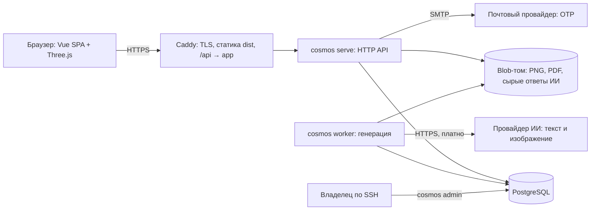
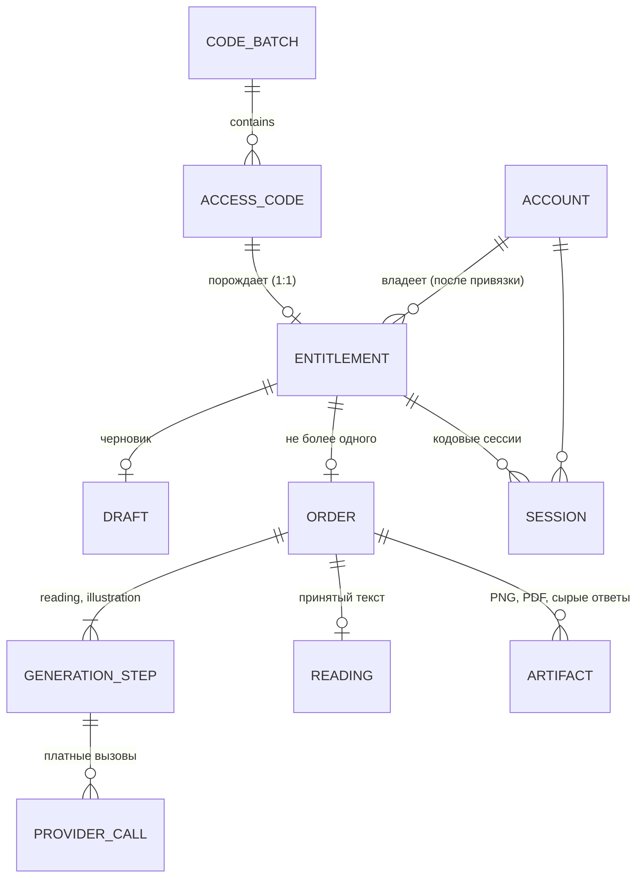
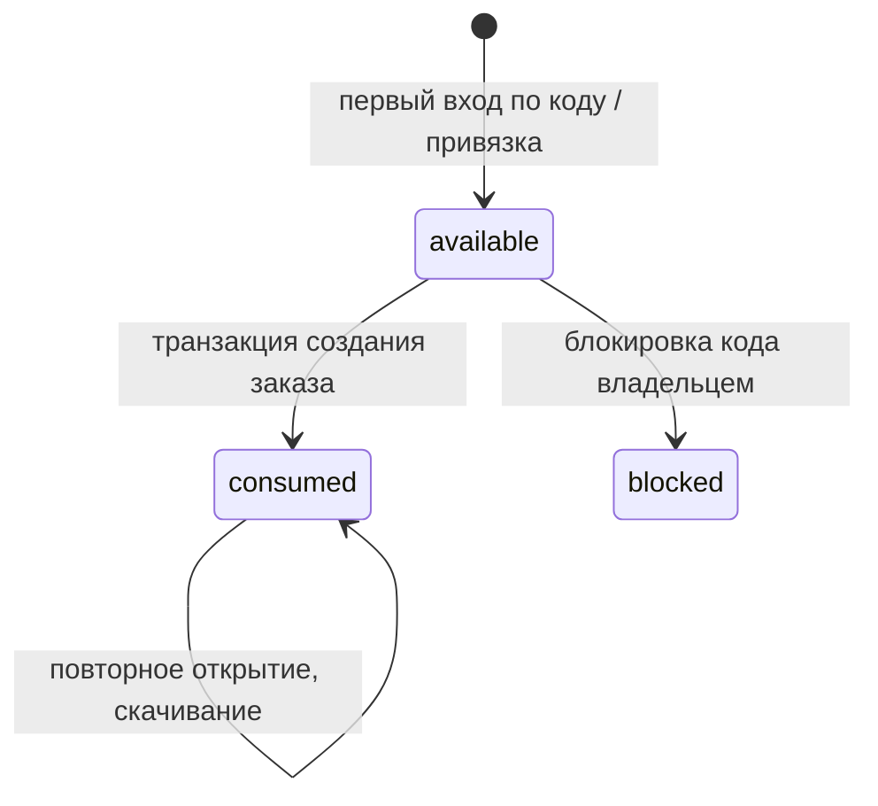
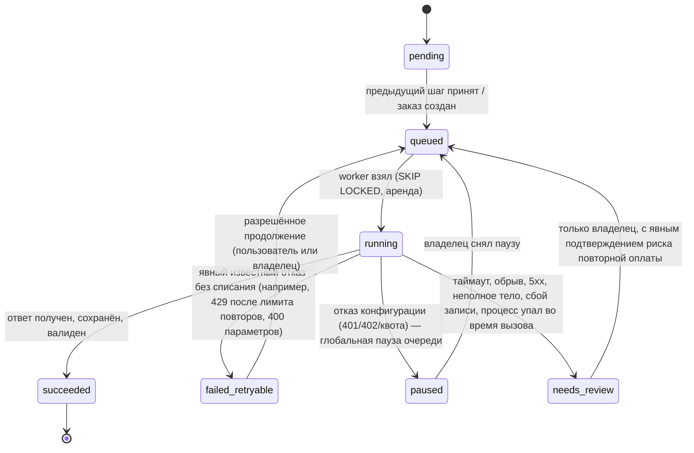

# Личный космос 2.0 — архитектура MVP v1

Дата: 2026-11-11. Статус: **проект на согласование**. Реализация не начинается до утверждения этого документа и ответов на открытые вопросы (§22). Решения владельца от 2026-11-11 по Q1, Q3, Q7, Q8, Q15 уже внесены.

Основание: `AGENTS.md`, `docs/PROJECT_DECISIONS.md`, `docs/product/PRODUCT_MVP_SCOPE_v1.md`, `docs/frontend/*` (SCREEN_SPEC v2, DESIGN_SYSTEM, MOTION_SPEC, FRONTEND_ACCEPTANCE, `references/hero-approved.png`), `docs/legacy/00–04`. Legacy используется только как источник бизнес-правил; архитектура, схемы БД и API ниже — новые.

---

## 0. Краткое резюме решений

| Область | Решение |
|---|---|
| Форма системы | Модульный монолит: один Go-бинарник `cosmos` (роли `serve`, `worker`, `migrate`, `admin`), PostgreSQL, Caddy. Без брокеров очередей, без Redis, без Kubernetes |
| Очередь ИИ | Таблицы PostgreSQL + `FOR UPDATE SKIP LOCKED` + аренды (lease) + `LISTEN/NOTIFY`. Перед каждым платным вызовом фиксируется «резервация» (intent log); незавершённая резервация после сбоя → `needs_review`, никогда не автоповтор |
| Право на услугу | Единая сущность **Entitlement** («доступ»): один доступ → максимум один заказ (`UNIQUE(entitlement_id)` в `orders`). Код порождает доступ; аккаунт владеет доступами; кодовая сессия — доступом без аккаунта |
| Создание заказа | Валидация → локальный расчёт **вне** транзакции → короткая транзакция: блокировка доступа, вставка заказа, расход доступа, постановка шагов генерации. Идемпотентность: естественный ключ `entitlement_id` + `Idempotency-Key` + fingerprint анкеты |
| Гостевой черновик | До появления идентичности — только в `sessionStorage` вкладки (рекомендация, требует утверждения); после входа по коду/почте — серверный черновик на конкретный доступ |
| Сессии | Серверные (таблица), opaque-токен 256 бит в cookie `__Host-` (HttpOnly, Secure, SameSite=Lax), в БД — только хэш. Два вида принципала: `account` и `code` |
| Астрономия | Чистый Go-модуль `astro` за интерфейсом эфемерид; выбор движка — отдельный технический спайк с golden-тестами точности (§12) |
| Файлы | Текст разбора — JSONB в PostgreSQL; PNG и кэш PDF — content-addressed blob-хранилище (локальный том в MVP, S3-совместимое позже); TXT формируется на лету |
| API | REST `/api/v1`, контракт OpenAPI 3.1 — единственный источник истины, генерация TS-типов, ошибки в формате RFC 9457 со стабильным `code` |
| Frontend | Vue 3 + TS + Vite, Vue Router, Pinia, Motion for Vue; Caddy раздаёт статический `dist`, Go отдаёт только API |
| 3D | Один постоянный canvas на всё приложение («один непрерывный космос»), `SceneDirector` с одним RAF-циклом, композиции по маршрутам, уровни качества, статический fallback-постер |
| Владелец | MVP: CLI `cosmos admin …` по SSH (партии, выпуск, CSV, блокировка, разбор `needs_review`). Без веб-админки |
| Развёртывание | Один VPS, Docker Compose: `caddy`, `app` (api+worker), `postgres`. Резервные копии БД+blob на внешнее хранилище, проверяемое восстановление |

---

## 1. Найденные противоречия и как они разрешены

| # | Противоречие | Разрешение по приоритету `AGENTS.md` |
|---|---|---|
| C1 | `PRODUCT_MVP_SCOPE_v1` §«Основной сценарий» и legacy: «код/вход → анкета». `PROJECT_DECISIONS` п.5 и SCREEN_SPEC v2: «анкета → доступ» | Применяется п.5 PROJECT_DECISIONS. Поддерживаются и прямые входы `/activate`, `/login` (п.6) |
| C2 | DESIGN_SYSTEM и FRONTEND_ACCEPTANCE ссылаются на `references/hero-approved-source.png`; в репозитории есть только `references/hero-approved.png` | Эталоном считается существующий `hero-approved.png`. Предлагаю исправить ссылки в документах |
| C3 | SCREEN_SPEC v2 ссылается на `SCREEN_SPEC_MVP_v1.md` как на контекст для неизменённых экранов — файла нет | Считаю v2 полным реестром экранов MVP. Если v1 существует у владельца, его нужно добавить |
| C4 | Названия статусов генерации: legacy `retryable_error`, SCREEN_SPEC `failed_retryable`; спецификация просит «уточнить в API» | В API используются имена SCREEN_SPEC: `queued`, `writing`, `illustrating`, `ready`, `failed_retryable`, `needs_review` (+ `calculated`, если ИИ выключен) — §13.6 |
| C5 | MOTION_SPEC §8 п.4: как показывать «расчёт», если сервер считает быстро | Карта рассчитывается синхронно при создании заказа; к моменту открытия `/orders/:id/creating` она уже есть. Сцена сразу показывает «Карта рассчитана», без имитации расчёта |
| C6 | Legacy запрещает перенос кодового заказа в кабинет во время генерации — это следствие старой реализации (перенос файлов и строк) | В новой модели владение выводится из доступа, перенос — смена одного поля. Привязка во время генерации разрешена (решение Q8) |
| C7 | Legacy: сессия 24 часа, stateless HMAC без отзыва | Новые серверные сессии с отзывом; сроки — открытый вопрос (Q2) |
| C8 | SCREEN_SPEC §4 предлагает `sessionStorage`, но помечает это как неутверждённое; PROJECT_DECISIONS оставляет вопрос открытым | Решено (Q1): только `sessionStorage`, см. §8 |
| C9 | Legacy `GET /api/cities` требует сессию; новый путь требует поиск мест для гостя | Новый публичный endpoint с ограничением частоты (SCREEN_SPEC §11 прямо называет это новой задачей) |

Противоречий, которые меняют инварианты, не найдено: все 10 инвариантов `PRODUCT_MVP_SCOPE_v1` совместимы с новым порядком шагов.

---

## 2. Архитектурные драйверы

| Инвариант / требование | Архитектурный механизм |
|---|---|
| Один доступ → максимум один заказ | `UNIQUE(orders.entitlement_id)`, `SELECT … FOR UPDATE` строки доступа, fingerprint анкеты |
| Проверка/привязка ≠ расход | Разные операции и состояния: `code login`, `claim` не меняют `entitlements.state`; расход только в транзакции создания заказа |
| Ошибка расчёта не расходует право | Расчёт до транзакции; при ошибке транзакция не открывается |
| Свой заказ — только владельцу | Авторизация через доступ в каждом запросе; чужое → `404` |
| Нет выдуманных домов/углов | Тип карты с режимами `known/range/unknown`; в `unknown` поля домов/углов отсутствуют структурно, а не «пустые» |
| Платный ИИ, неизвестный исход → ручная проверка | Протокол резервации платного вызова (§13.3), запрет автоповтора неопределённых исходов |
| Повторное открытие/PDF без генерации | Чтение только из сохранённых материалов; PDF из blob + БД; эндпоинтов «перегенерировать» нет |
| Повторы и конкуренция | Идемпотентные операции, уникальные ограничения, `SKIP LOCKED`, аренды с истечением |
| Не усложнять инфраструктуру | Один процесс, одна БД, один VPS; всё распределённое — только через PostgreSQL |

---

## 3. Обзор системы



В MVP `serve` и `worker` работают в одном процессе (флаг конфигурации), но код ролей разделён: при необходимости worker выносится в отдельный контейнер без изменения логики, а несколько worker'ов безопасны благодаря `SKIP LOCKED` и арендам (в отличие от legacy с единственным advisory lock).

---

## 4. Структура монорепозитория

```
/
├── AGENTS.md, README.md
├── Makefile (или Taskfile.yml)      # единые команды: lint, test, gen, dev, build
├── api/
│   └── openapi.yaml                 # контракт frontend/backend — источник истины
├── backend/                         # Go-модуль
│   ├── go.mod
│   ├── cmd/cosmos/                  # единственный main: serve | worker | migrate | admin
│   ├── internal/
│   │   ├── app/                     # composition root: сборка зависимостей
│   │   ├── httpapi/                 # транспорт: роутинг, DTO, middleware, ошибки
│   │   ├── identity/                # аккаунты, OTP, сессии, принципал
│   │   ├── access/                  # коды, партии, доступы, привязка
│   │   ├── intake/                  # Profile, валидация, нормализация, черновики
│   │   ├── places/                  # справочник мест, поиск
│   │   ├── astro/                   # чистый расчёт карты (без БД и сети)
│   │   ├── orders/                  # создание и чтение заказов
│   │   ├── generation/              # шаги, worker, провайдеры, валидатор текста
│   │   ├── artifacts/               # blob-метаданные, TXT, PDF, SVG-круг карты
│   │   ├── mail/                    # отправка OTP (SMTP, fake)
│   │   ├── audit/                   # журнал действий владельца и системы
│   │   └── platform/                # config, postgres (tx), blob, clock, secret, ratelimit, observability
│   ├── migrations/                  # SQL-миграции (goose)
│   └── testdata/                    # golden-данные эфемерид, фикстуры ответов ИИ
├── frontend/                        # Vite + Vue 3 + TS
│   ├── src/ …                       # см. §16
│   └── public/
├── e2e/                             # Playwright: сквозные E2E-01…13, визуальные снимки
├── deploy/
│   ├── compose.yaml, compose.dev.yaml
│   ├── Caddyfile
│   └── ops/                         # бэкап, восстановление, runbook'и
└── docs/
    ├── architecture/                # этот документ, ADR
    └── …                            # существующие документы
```

Решения:
- Go-модуль в `backend/`, а не в корне: изолирует Go-инструменты от `node_modules` и делает границы понятными агентам. Текущие корневые `go.mod`/`main.go` — шаблон IDE, удаляются в срезе 0.
- Один бинарник с подкомандами — один артефакт сборки, одна конфигурация, одни миграции.
- `api/openapi.yaml` вне обеих частей: изменения контракта видны в одном месте и проверяются CI с обеих сторон.
- Нет `pkg/`, `common/`, `utils/`: общий код — только инфраструктурный в `platform/`.

---

## 5. Модульная архитектура Go

### 5.1. Модули и ответственность

| Модуль | Владеет таблицами | Ответственность | Зависит от |
|---|---|---|---|
| `identity` | `identity.*` | Аккаунты по email, OTP-челленджи, сессии, разрешение принципала из cookie | `mail`, `platform` |
| `access` | `access.*` | Партии и коды, хэширование/шифрование кодов, доступы (entitlements), кодовый вход, привязка к аккаунту, блокировка | `platform`, `audit` |
| `intake` | `intake.drafts` | Тип `Profile`, валидация и нормализация, проверка DST-неоднозначности, черновики на доступ | `places` |
| `places` | `places.*` | Справочник, поиск, разрешение `place_id` → координаты + IANA tz | `platform` |
| `astro` | — | Чистые функции: вход (момент/интервал, координаты) → `Chart`. Без I/O | — |
| `orders` | `orders.*` | Сценарий создания заказа, авторизация чтения, проекция для клиента | `access`, `intake`, `places`, `astro`, `generation` (постановка) |
| `generation` | `generation.*` | Шаги текста/иллюстрации, worker, резервации платных вызовов, адаптеры провайдеров, валидатор текста, восстановление | `orders` (чтение карты), `access` (проверка права), `artifacts` |
| `artifacts` | `artifacts.*` | Метаданные blob, сборка TXT/PDF, SVG карты | `platform/blob` |
| `mail` | — | Интерфейс отправки + SMTP и fake | — |
| `audit` | `audit.events` | Запись событий | — |
| `httpapi` | — | HTTP-транспорт поверх сервисов модулей | все сервисы |
| `app` | — | Сборка, жизненный цикл, graceful shutdown | всё |

### 5.2. Правила слоёв

- Внутри модуля: доменные типы и переходы состояний (чистый код) → сервис сценариев → адаптер PostgreSQL. HTTP-код в модулях отсутствует, он целиком в `httpapi`.
- Интерфейсы объявляются на стороне потребителя (например, `generation` объявляет `EntitlementChecker`, реализуемый `access`).
- Межмодульная транзакция: модуль-оркестратор (`orders`) открывает транзакцию через `platform/postgres.WithTx`, а функции других модулей принимают явный `Querier` (tx). Каждый модуль пишет только в свои таблицы. Это сознательный компромисс модульного монолита ради атомарности без распределённых протоколов.
- Циклы запрещены; правило зависимостей проверяется линтером (`depguard` в golangci-lint) в CI.
- Конструкторы `New…` с DI, никаких глобальных синглтонов и `init()`.

### 5.3. Процессы и жизненный цикл

- `cosmos serve [--with-worker]` — HTTP API (+ worker в том же процессе в MVP).
- `cosmos worker` — только генерация (для будущего выноса).
- `cosmos migrate up|status` — миграции, запускаются отдельным шагом деплоя.
- `cosmos admin …` — операции владельца (§10.6, §13.8).
- Graceful shutdown: перестать принимать HTTP → перестать брать новые шаги → дождаться текущего платного вызова в пределах `grace` (≥ таймаут провайдера) → закрыть пул. Если платный вызов не успел завершиться, шаг уйдёт в `needs_review` при восстановлении — это безопасно, но деплой следует проводить при пустой активной очереди (проверка в скрипте деплоя).

---

## 6. Доменная модель и границы

### 6.1. Сущности

| Сущность | Модуль | Суть |
|---|---|---|
| `Account` | identity | Подтверждённый email (уникален), статус `active/disabled` |
| `EmailChallenge` | identity | OTP: HMAC кода, срок, попытки, использован |
| `Session` | identity | Серверная сессия; принципал `account` или `code` |
| `CodeBatch` | access | Партия: метка, продукт, размер, состояние `prepared/issued` |
| `AccessCode` | access | Код: HMAC для поиска, шифротекст для экспорта, маска, состояние `prepared/issued/blocked` |
| `Entitlement` | access | **Одно право на один заказ.** Источник (`code`; в будущем `purchase`), владелец (`account_id` или пусто), состояние `available/consumed/blocked` |
| `Draft` | intake | Серверный черновик анкеты для конкретного доступа |
| `Profile` | intake | Значение: имя, дата, место (`place_id`), время/неизвестно, источник, погрешность |
| `Place` | places | Справочное место: подпись, координаты, IANA tz |
| `Order` | orders | Неизменяемый снимок анкеты и места, карта, версия согласия, ссылка на доступ, итоговый статус |
| `Chart` | astro | Версионированный результат расчёта (значение, хранится в заказе) |
| `GenerationStep` | generation | Шаг `reading` или `illustration` заказа со своим состоянием и арендой |
| `ProviderCall` | generation | Резервация и исход одного платного вызова |
| `Reading` | generation | Принятый валидированный текст (8 разделов, вопросы, visual concept, символы) |
| `Artifact` | artifacts | Ссылка заказа на blob: `illustration_png`, `report_pdf`, `raw_response` |

### 6.2. Связи



### 6.3. Ключевая идея: доступ отделён от кода и от заказа

- **Код** — секрет-носитель (то, что продаётся на внешней площадке).
- **Доступ** — право на одну услугу. Создаётся при первом успешном предъявлении выпущенного кода (кодовый вход или привязка), 1:1 с кодом. Будущие банковские покупки создадут доступы без кода — модель заказа и генерации не изменится.
- **Владение заказом выводится из доступа**: `account_id` доступа, либо (если `account_id` пуст) кодовая сессия этого доступа. Отдельной колонки владельца у заказа нет → перенос в кабинет — атомарное изменение одного поля, без копирования файлов.

### 6.4. Состояния доступа



Привязка к аккаунту — не переход состояния, а изменение владельца (`account_id: NULL → acct`), допустимое в `available` и `consumed`. Перепривязка другому аккаунту запрещена.

---

## 7. Архитектура PostgreSQL

### 7.1. Общие решения

- PostgreSQL 18 (если доступен в целевом окружении; иначе 17 — схема не зависит от версии). Драйвер `pgx` v5, пул ~10 соединений.
- Схемы PostgreSQL по модулям: `identity`, `access`, `intake`, `places`, `orders`, `generation`, `artifacts`, `audit`, `ops`. Модуль пишет только в свою схему; FK между схемами допустимы ради целостности.
- Первичные ключи — UUIDv7, генерируются в Go (сортируемые по времени, неугадываемые для внешних ссылок; авторизация всё равно обязательна).
- Статусы — `text` + `CHECK`, а не enum-типы (проще миграции).
- Время — `timestamptz`, UTC; московская дата для правила «не позже сегодня» вычисляется в приложении.
- Уровень изоляции — READ COMMITTED + явные `SELECT … FOR UPDATE` + уникальные ограничения. SERIALIZABLE не нужен.
- Миграции — goose (SQL-файлы), только вперёд, по схеме expand/contract.

### 7.2. Таблицы (описание, не DDL)

**identity**

| Таблица | Ключевые поля | Ограничения |
|---|---|---|
| `accounts` | id, email (citext), status, created_at | `UNIQUE(email)` |
| `email_challenges` | id, email, code_hmac, expires_at, attempts, consumed_at, ip_hmac, created_at | индекс (email, created_at) для лимитов |
| `sessions` | id, token_hash (bytea), kind `account/code`, account_id, entitlement_id, created_at, last_seen_at, expires_at, revoked_at | `UNIQUE(token_hash)`; `CHECK`: ровно один субъект в соответствии с kind |

**access**

| Таблица | Ключевые поля | Ограничения |
|---|---|---|
| `code_batches` | id, label, product, size, state, idempotency_key, created_by, created_at, issued_at | `UNIQUE(idempotency_key)` |
| `codes` | id, batch_id, lookup_hmac, ciphertext, nonce, mask, state, blocked_reason, key_version | `UNIQUE(lookup_hmac)` |
| `entitlements` | id, product, source, code_id, account_id, state, created_at, claimed_at, consumed_at | `UNIQUE(code_id)`; `CHECK(state IN …)` |

**intake**: `drafts` — entitlement_id (PK), profile (jsonb), updated_at, expires_at.

**places**: `places` — id, geonames_id, name_ru, name, admin1_ru, country_ru, lat, lon, tz, population; `place_names` — place_id, name_normalized (GIN `pg_trgm`). Импорт CLI из выгрузки GeoNames (лицензия CC BY 4.0 → нужна атрибуция на сайте).

**orders**: `orders` — id, entitlement_id, product, idempotency_scope, idempotency_key, request_fingerprint, profile (jsonb, снимок), place (jsonb, снимок подписи/координат/tz), chart (jsonb), chart_version, consent_version, consent_accepted_at, status, created_at, updated_at.
Ограничения: `UNIQUE(entitlement_id)`, `UNIQUE(idempotency_scope, idempotency_key)`. Статус — отдельная колонка (в legacy он был внутри JSONB).

**generation**

| Таблица | Ключевые поля | Ограничения |
|---|---|---|
| `steps` | id, order_id, kind `reading/illustration`, state, attempts, run_after, lease_owner, lease_until, last_error_code, updated_at | `UNIQUE(order_id, kind)`; частичный индекс по (state, run_after) для выборки очереди |
| `provider_calls` | id, step_id, purpose `initial/expansion/illustration`, provider, model, request_sha256, state `started/succeeded/failed_definitive/uncertain`, http_status, started_at, finished_at, response_blob_id | индекс (step_id, state) |
| `readings` | order_id (PK), content (jsonb), word_count, schema_version, source_call_id, accepted_at | — |

**artifacts**: `blobs` — id, sha256, size, mime, storage_key, created_at (`UNIQUE(sha256)`); `order_artifacts` — order_id, kind, blob_id, template_version (`UNIQUE(order_id, kind, template_version)`).

**audit**: `events` — id, actor, action, subject_type, subject_id, data (jsonb без секретов и ПДн), at.

**ops**: `rate_counters` (ключ-хэш, окно, счётчик) для OTP и кодовых попыток; `flags` (например, `generation_paused` с причиной).

### 7.3. Порядок блокировок

Единый для всех операций: `codes` → `entitlements` → `orders` → `generation.steps`. Любая новая операция, меняющая несколько из них, обязана следовать этому порядку (фиксируется в ADR и проверяется конкурентными тестами).

### 7.4. Хранение ПДн

- Данные рождения хранятся только в черновиках (`intake.drafts`) и снимке заказа.
- Черновики имеют `expires_at` (предложение: 30 дней без изменений) и удаляются фоновой очисткой; при создании заказа черновик удаляется в той же транзакции.
- OTP-челленджи и отозванные сессии очищаются по сроку.
- В `audit.events` и логах — только идентификаторы, без имени, даты, места, email, кодов.

---

## 8. Гостевые черновики

### 8.1. Варианты

| Вариант | Плюсы | Минусы |
|---|---|---|
| **A. `sessionStorage` вкладки** | Ноль серверных ПДн до появления клиента; переживает перезагрузку и OTP в той же вкладке; просто | Закрытие вкладки стирает анкету; нет переноса между устройствами |
| B. A + добровольный `localStorage` («запомнить на этом устройстве», TTL 7 дней) | Переживает закрытие браузера | ПДн остаются на устройстве (общие компьютеры); шифрование в браузере ключом из браузера не защищает |
| C. Серверный гостевой черновик по анонимной cookie | Переживает закрытие браузера | Хранение ПДн людей, ещё не ставших клиентами; новая анонимная сессия, лимиты, очистка; кросс-девайс всё равно невозможен без входа |

### 8.2. Рекомендация

**Вариант A** — утверждён владельцем 2026-11-11 (Q1); варианты B и C в MVP не реализуются. Обоснование: весь гостевой путь, включая OTP (код, а не magic link), проходит в одной вкладке; SCREEN_SPEC §10 п.2 прямо запрещает обещать кросс-девайс восстановление.

### 8.3. Жизненный цикл

1. `/create` — Pinia-хранилище анкеты с версионированной схемой, сохраняется в `sessionStorage` при каждом изменении поля; TTL 24 часа внутри записи. В URL, аналитику и логи данные не попадают.
2. `/create/review` — клиент вызывает публичный `POST /api/v1/profile-checks`: сервер нормализует анкету, проверяет место и DST-неоднозначность, **ничего не сохраняет**. Ошибки показываются до шага доступа.
3. `/create/access`:
   - **Код** → кодовая сессия; если у доступа уже есть серверный черновик с другими данными — пользователь явно выбирает, какой оставить (не перезаписывать молча); иначе гостевая анкета сохраняется как черновик доступа.
   - **Email OTP** → аккаунтная сессия; анкета остаётся в `sessionStorage`; пользователь выбирает свободный доступ (или привязывает код) — анкета сохраняется как черновик выбранного доступа.
   - **Код уже использован** → предложение открыть прежний результат; гостевая анкета остаётся нетронутой для другого кода.
4. `/create/consent` → создание заказа с анкетой из черновика (сервер повторно валидирует). После успеха клиентский черновик и ключ идемпотентности удаляются.

Серверный черновик (F11) нужен для кабинета («заполнить позже», несколько доступов), но не является источником истины для заказа: заказ получает анкету в теле запроса и сравнивает fingerprint.

---

## 9. Авторизация и сессии

### 9.1. Принципалы

| Принципал | Как получается | Что разрешает |
|---|---|---|
| Аноним | Нет cookie | Публичные страницы, поиск мест, проверка анкеты, вход |
| `code` | `POST /auth/code` с действующим кодом, доступ которого не привязан к аккаунту | Свой доступ, его черновик, создание заказа по нему, свой заказ и файлы |
| `account` | OTP по email | Все доступы аккаунта, привязка кодов, черновики, заказы, файлы |
| Владелец | Только CLI на сервере | Операции §10.6, §13.8. Нет веб-входа в MVP |

Одна сессия — один принципал. Вход другим способом заменяет текущую сессию (старая отзывается).

### 9.2. Сессии

- Токен: 32 байта CSPRNG, base64url, в cookie `__Host-lk_sid` (`HttpOnly`, `Secure`, `SameSite=Lax`, `Path=/`). В БД — SHA-256 от токена.
- Проверка при каждом запросе: сессия не отозвана и не истекла; для `account` — аккаунт активен; для `code` — доступ существует, `account_id IS NULL`, код не заблокирован для новых операций.
- Сроки (предложение, Q2): `account` — 30 дней абсолютный, 7 дней бездействия; `code` — 7 дней. `last_seen_at` обновляется не чаще раза в N минут.
- Выход: `DELETE /api/v1/session` отзывает серверную запись и очищает cookie.
- После привязки кода к аккаунту все кодовые сессии этого доступа становятся недействительными автоматически (из-за условия `account_id IS NULL`).
- Bearer-токены не поддерживаются: клиент только браузер того же origin.

### 9.3. OTP

- Email: нормализация (trim, lower), проверка формата и длины ≤ 254.
- Код: 6 цифр CSPRNG, в БД — HMAC(ключ OTP, challenge_id‖код). Срок 10 минут, ≤ 5 попыток, одноразовый; проверка и списание попытки — под блокировкой строки.
- Лимиты в PostgreSQL (переживают рестарт): на email, на IP-хэш и глобально (стартово — legacy-значения: 3/50/500 за 10 минут), повторная отправка не раньше 60 секунд.
- Отправка письма синхронно в запросе с таймаутом; при сбое — `503 mail_unavailable`, сессия не выдаётся, черновик клиента не трогается.

### 9.4. Защита от CSRF и подделки

- Для всех небезопасных методов — строгая проверка `Origin` против конфигурации + `Content-Type: application/json` + `SameSite=Lax`.
- CORS не открывается (SPA и API на одном origin).

### 9.5. Авторизация объектов

Каждый запрос к доступу/заказу/файлу выполняется запросом, в котором условие владения входит в `WHERE` (доступ принадлежит аккаунту принципала, либо это доступ кодовой сессии и `account_id IS NULL`). Нет строки → `404 not_found`, без различия «нет» и «чужое».

---

## 10. Активационные коды и права доступа

### 10.1. Формат кода

- 120 бит случайности, Crockford Base32 (без I/L/O/U), группы по 4–5 символов + 1 контрольный символ, префикс продукта. Пример формы: `LK-XXXXX-XXXXX-XXXXX-XXXXX-XXXXX` (синтетический шаблон).
- Нормализация ввода: верхний регистр, удаление пробелов/дефисов, замена похожих символов; контрольный символ отсекает опечатки до обращения к БД (без расхода лимитов).

### 10.2. Хранение

- `lookup_hmac = HMAC-SHA256(CODE_LOOKUP_KEY, нормализованный код)` — для поиска; `UNIQUE`.
- `ciphertext = AES-256-GCM(CODE_VAULT_KEY, код)`, AAD = `code_id‖batch_id‖product`, отдельный nonce — для повторного CSV и раскрытия владельцем (с аудитом).
- `mask` — последние 4 символа для списков.
- Ключи вне БД и вне Git; в БД хранится только отпечаток версии ключа для обнаружения несовпадения.

### 10.3. Состояния и операции

| Операция | Кто | Эффект | Расход? |
|---|---|---|---|
| Создать партию 1–500 | Владелец (CLI) | Коды `prepared`; идемпотентно по ключу | — |
| Выпустить партию | Владелец | `prepared → issued` | — |
| Экспорт CSV | Владелец | Файл на сервере (UTF-8 BOM, `;`, защита от формул) | — |
| Блокировать код/партию с причиной | Владелец | `prepared/issued → blocked`; связанный `available` доступ → `blocked` | — |
| Кодовый вход | Клиент | Создать доступ при первом предъявлении (или найти существующий), выдать кодовую сессию | Нет |
| Привязать код к аккаунту | Клиент `account`, явное подтверждение | `entitlement.account_id = acct` | Нет |
| Создать заказ | Владелец доступа | `available → consumed` | **Да** |

Ответы на кодовый вход:
- неизвестный / не выпущенный / заблокированный / не тот продукт → единая ошибка `code_invalid` (без деталей);
- доступ привязан к аккаунту → `code_bound_to_account` («войдите по почте»);
- доступ `consumed`, не привязан → кодовая сессия + `order_id` (открыть прежний результат);
- доступ `available` → кодовая сессия.

### 10.4. Привязка (claim)

Транзакция: блокировка `codes` → `entitlements` (создать, если нет). Если `account_id` = этот аккаунт → вернуть существующий (идемпотентно). Если другой аккаунт → `409 code_claimed_elsewhere`. Если пусто → установить, вернуть доступ (с `order_id`, если уже использован — это и есть перенос кодового результата, U-C). Кодовые сессии доступа перестают действовать.

### 10.5. Блокировка после использования

Предложение (подтвердить, Q9): блокировка кода с `consumed`-доступом запрещает **новые платные шаги** (worker проверяет перед каждым вызовом), но не скрывает уже сохранённый результат. Штатной разблокировки в MVP нет (как в legacy).

### 10.6. Интерфейс владельца

CLI `cosmos admin codes batch-create | batch-issue | export | block | status | search` с подтверждением ввода, записью в `audit.events` и выводом файлов только на сервер. Обоснование: ноль поверхности атаки веб-админки, F25 допускает CLI. Утверждено владельцем 2026-11-11 (Q7).

---

## 11. Атомарное и идемпотентное создание заказа

### 11.1. Контракт

`POST /api/v1/orders`, заголовок `Idempotency-Key` (16–80 символов `[A-Za-z0-9_-]`), тело `{entitlement_id, profile, consent_version}`.
Клиент генерирует ключ при входе на `/create/consent` и хранит рядом с fingerprint черновика; при смене анкеты или доступа ключ создаётся заново.

### 11.2. Алгоритм

```mermaid
sequenceDiagram
  participant B as Браузер
  participant A as API (orders)
  participant DB as PostgreSQL
  B->>A: POST /orders + Idempotency-Key
  A->>A: авторизовать доступ, проверить consent_version
  A->>A: валидировать Profile, разрешить место, fingerprint
  A->>DB: быстрый путь: заказ по entitlement_id уже есть?
  alt заказ есть
    A-->>B: 200 тот же заказ (fingerprint совпал) / 409 entitlement_used
  else
    A->>A: локальный расчёт карты (вне транзакции, таймаут, лимит параллельности)
    alt ошибка расчёта
      A-->>B: 422 calculation_failed (доступ не тронут)
    else
      A->>DB: BEGIN; доступ FOR UPDATE; проверки; INSERT order; доступ → consumed; INSERT steps; DELETE draft; audit; NOTIFY; COMMIT
      A-->>B: 201 заказ
    end
  end
```

Проверки внутри транзакции (после блокировки доступа):
1. Доступ всё ещё принадлежит принципалу и не `blocked`, код не заблокирован.
2. Если заказ по `entitlement_id` уже появился (гонка) → откат; ответ как в «быстром пути».
3. `consent_version` равна текущей серверной.
4. Вставка заказа; нарушение `UNIQUE(idempotency_scope, key)` с другим fingerprint → `409 idempotency_key_reused`.

### 11.3. Матрица повторов и гонок

| Ситуация | Результат |
|---|---|
| Двойной клик / сетевой повтор с тем же ключом | Второй запрос ждёт блокировку, видит заказ → `200` тот же заказ |
| Две вкладки, одинаковая анкета, разные ключи | Один заказ; второй ответ `200` с тем же заказом (fingerprint совпал) |
| Две вкладки, разные анкеты | Первый `201`; второй `409 entitlement_used` + ссылка на существующий заказ |
| Таймаут ответа у клиента | Клиент повторяет с тем же ключом или читает `GET /entitlements/{id}` → видит `order_id` |
| Ошибка расчёта / невалидная анкета / DST-неоднозначность | `422`, доступ `available` |
| Доступ заблокирован между проверкой и транзакцией | `409 entitlement_blocked`, ничего не создано |
| Падение процесса после COMMIT до ответа | Повтор с тем же ключом возвращает заказ |

Генерация ставится в очередь в той же транзакции (шаги `reading` и `illustration` = `queued`/`pending`) — это транзакционный outbox: заказ без поставленной генерации невозможен. Если ИИ выключен конфигурацией, шаги создаются, но worker их не берёт; заказ показывает `calculated`.

---

## 12. Астрономический расчёт

### 12.1. Продуктовые правила (переносятся из legacy как бизнес-требования, версия `natal/2`)

- 10 тел: Солнце, Луна, Меркурий–Плутон; тропический зодиак; геоцентрические видимые эклиптические долготы; скорость и ретроградность.
- Дома Плацидуса и ASC/MC/DSC/IC только при известном времени; на широтах, где Плацидус не определён, дома отсутствуют (без подмены системы).
- Аспекты: 0°/8°, 60°/4°, 90°/6°, 120°/6°, 180°/8°, только между телами.
- Режимы: `known`; `range` (погрешность ±15/30/60 — расчёт на срезах интервала, сохраняются только устойчивые признаки и «возможные знаки/дома»); `unknown` (весь реальный местный день, включая 23/25-часовые сутки; нет `birth_utc`, домов, углов).
- Запас у границы знака 0.02° → предупреждение о неопределённости.
- Эти правила требуют подтверждения владельцем как продуктовые (Q4), т.к. они не универсальный стандарт.

### 12.2. Время и часовые пояса

- Место → IANA tz из справочника; tzdata встраивается в бинарник; её версия записывается в карту.
- Локальное время → UTC с явной проверкой: несуществующее время (переход вперёд) → `422 birth_time_nonexistent`; повторяющееся (переход назад) → `422 birth_time_ambiguous` с двумя вариантами для явного выбора пользователем (UI выбора — небольшое расширение анкеты, Q10). Стандартная нормализация `time.Date` в Go молча сдвигает такие времена — её нельзя использовать без проверки.

### 12.3. Структура модуля

- `astro/ephemeris` — интерфейс `Ephemeris` (долгота, широта, скорость тела в момент; звёздное время; наклон эклиптики) и адаптер выбранного движка.
- `astro/houses` — собственная реализация ASC/MC и Плацидуса (стандартные формулы, тестируются по эталонам).
- `astro/natal` — построение `Chart` по правилам §12.1, чистые функции.
- Расчёт синхронный в запросе создания заказа, с `context` таймаутом (≈10 с) и семафором параллельности (защита CPU).
- Сохранённая карта никогда не пересчитывается; `chart_version` = версия правил + движка + tzdata.

### 12.4. Выбор движка — технический спайк

У Astronomy Engine (движок legacy) нет Go-версии; legacy запускал JS через Goja. Кандидаты:

| Кандидат | Лицензия | Плюсы | Минусы |
|---|---|---|---|
| Порт Astronomy Engine на чистый Go (с C-версии) | MIT | Точность ±1′ подтверждена автором, без cgo | Объём портирования и поддержки |
| Astronomy Engine C через cgo | MIT | Эталонное поведение без переписывания | cgo усложняет сборку и кросс-компиляцию |
| `soniakeys/meeus` (чистый Go, VSOP87, Луна по Meeus) | MIT | Готовая Go-библиотека | Плутон по Meeus ограничен диапазоном лет; надо проверить точность и поддержку |
| Swiss Ephemeris через cgo | AGPL или коммерческая | Отраслевой стандарт астрологии, дома встроены | Юридический риск для закрытого сервиса или платная лицензия |
| JS через Goja (как в legacy) | MIT | Известно, что работает | Медленно, интерпретатор в процессе; не цель нового проекта |

Критерии спайка: отклонение долгот от JPL Horizons ≤ 1′ на golden-наборе (1900–2030, все 10 тел, включая ретроградные периоды и смены знаков); ASC/MC/куспиды против независимого эталона; время расчёта `unknown`-режима < 300 мс; сборка статического Linux-бинарника. Рекомендация до спайка: чистый Go (порт или meeus) при прохождении критериев, cgo-C как запасной вариант. Swiss Ephemeris — только при осознанном решении о лицензии.

---

## 13. Фоновая генерация ИИ

### 13.1. Шаги

Заказ имеет два шага: `reading` (текст + visual concept + символы) и `illustration` (PNG по visual concept). `illustration` становится `queued` только после принятия `reading`.

### 13.2. Состояния шага



### 13.3. Протокол резервации платного вызова (ключевой механизм)

1. Worker берёт шаг: `UPDATE … WHERE id = (SELECT … FOR UPDATE SKIP LOCKED LIMIT 1) RETURNING`, ставит `running`, `lease_until = now + таймаут провайдера + запас`.
2. Повторно проверяет право: доступ не `blocked`, код не заблокирован, нет глобальной паузы, не превышен бюджет.
3. Если для шага уже есть принятый результат (`readings`/артефакт) — завершает шаг без вызова.
4. **Отдельной зафиксированной транзакцией** вставляет `provider_calls(state=started, request_sha256, model, purpose)`. Только после COMMIT выполняется HTTP-запрос.
5. Получив полный ответ: сначала сохраняет сырой ответ в blob (временный файл → fsync → rename), затем в одной транзакции: `provider_calls → succeeded`, валидация, `readings`/артефакт, шаг `succeeded`, следующий шаг `queued`, статус заказа.
6. Определённый отказ без результата → `provider_calls → failed_definitive`, шаг по таблице классификации.
7. Любая неопределённость → `provider_calls → uncertain`, шаг `needs_review`.

**Восстановление** (при старте и периодически): шаг `running` с истёкшей арендой →
- если у шага есть `provider_calls` в состоянии `started` → `uncertain` + шаг `needs_review` (вызов мог быть оплачен);
- если резервации нет (упал до шага 4) → шаг безопасно возвращается в `queued`;
- если сырой ответ сохранён, но транзакция не завершилась → повторная валидация сохранённого ответа без нового вызова.

Это даёт гарантию: **платный вызов для шага делается автоматически не более одного раза на резервацию**, а сбой в «тёмной зоне» всегда превращается в ручную проверку.

### 13.4. Классификация ответов провайдера (стартовая, из legacy)

| Событие | Шаг |
|---|---|
| Явный 429 без исчерпания квоты | Одна автоматическая попытка через паузу (новая резервация), затем `failed_retryable` |
| 401/403, 402, исчерпание квоты/баланса | `paused` + глобальная пауза очереди + оповещение |
| 400/404/422 (параметры, модель) | `failed_retryable` после исправления конфигурации владельцем |
| Таймаут, обрыв, 5xx, неполное тело, `finish_reason` ≠ stop, refusal | `needs_review` |
| Ответ получен, JSON невалиден по схеме | `needs_review` (деньги потрачены; решение о повторе — владельцу) |
| Ответ валиден, но короче 1800 слов | Одна ограниченная доработка (`purpose=expansion`, своя резервация); если снова короткий → `needs_review` |
| Сбой записи результата | `needs_review` |

### 13.5. Контракт текста и валидация

- Строгая JSON Schema структурированного ответа: summary, 8 разделов с фиксированными ключами и порядком (`overview, character, emotions, communication, relationships, work, challenges, integration`), 5–8 вопросов, visual concept, 3–5 символов, ссылки на ID рассчитанных показателей.
- Серверный валидатор (независимо от схемы провайдера): структура, ссылки только на существующие показатели карты, отсутствие нерассчитанных точек (Лилит, Хирон, узлы), счёт слов по Unicode-буквам/цифрам, **1800–2700 слов** (summary + заголовки + тексты + вопросы).
- В запрос к ИИ не передаются имя, email, дата/время/место рождения, координаты, код, идентификаторы. Передаются только рассчитанные показатели и сведения о неопределённости (`readingFacts`).
- Изображение: один запрос, PNG 1024×1536, проверка декодирования и размеров.

### 13.6. Статус заказа для клиента

`orders.status` — денормализованная сводка, обновляется в тех же транзакциях, что и шаги:

| Статус | Когда |
|---|---|
| `calculated` | Карта есть, генерация выключена конфигурацией |
| `queued` | Шаг `reading` в очереди |
| `writing` | `reading` выполняется |
| `illustrating` | Текст принят, `illustration` в очереди/выполняется |
| `ready` | Оба шага `succeeded` |
| `failed_retryable` | Шаг остановлен с известным исходом, продолжение разрешено |
| `needs_review` | Остановка до ручной проверки (включая `paused`) |

Дополнительно в ответе: `reading_ready`, `illustration_ready`, `can_resume`, `support_reference`. Процентов прогресса нет.

### 13.7. Бюджет и защита от сжигания денег

- Глобальная параллельность платных вызовов (по умолчанию 1–2) и дневной лимит вызовов; при превышении шаги остаются `queued`, без вызова.
- Автопредохранитель: N подряд отказов конфигурации → `ops.flags.generation_paused` + оповещение.
- Пользовательское «Продолжить» (`POST …/generation/resume`) разрешено только при `failed_retryable` и не более K раз на заказ; при `needs_review` кнопки нет.
- Вопрос к владельцу (Q5): разрешить ли режим провайдера, который позволяет получить результат по ID после сбоя (например, фоновые ответы с хранением на стороне провайдера). Это сократит число `needs_review`, но означает хранение данных у провайдера.

### 13.8. Ручная проверка

CLI: `cosmos admin generation review-list | show <order> | requeue <order> --step … --ack-possible-double-charge --reason … | resume-paused`. Каждое действие — запись в `audit.events`. Клиент при `needs_review` видит уже готовые материалы, номер обращения и контакты поддержки.

---

## 14. Хранение PNG, PDF и текстовых результатов

| Материал | Где | Как |
|---|---|---|
| Принятый текст | `generation.readings.content` (JSONB) | Источник для страницы, TXT и PDF |
| TXT | Не хранится | Детерминированно собирается из `readings` при скачивании |
| PNG | Blob-хранилище + `order_artifacts` | Записывается один раз; content-addressed по SHA-256 |
| PDF | Blob-кэш + `order_artifacts(template_version)` | Собирается лениво при первом скачивании из сохранённых материалов; ключ кэша = версия шаблона + хэши входов; параллельные сборки объединяются (singleflight) |
| Сырые ответы провайдера | Blob | Для аудита и восстановления; клиенту не отдаются |

Blob-хранилище — интерфейс `BlobStore` (`Put`, `Open`, `Stat`). MVP: локальный том вне корня веб-сервера, запись через временный файл + fsync + rename, права только для пользователя приложения. Позже — S3-совместимое хранилище тем же интерфейсом.

Согласованность с БД: blob всегда записывается **до** ссылки на него в транзакции; бэкап делает сначала `pg_dump`, затем копию blob-каталога → в копии blob ⊇ ссылки.

PDF-движок (Q6, спайк):
- **Typst** (CLI-подпроцесс, шаблон в репозитории): качественная типографика, кириллица, детерминированность, лёгкий; круг карты передаётся как SVG, сгенерированный в Go.
- Chromium (например, через Gotenberg): HTML/CSS-вёрстка, максимальная близость к сайту, но тяжёлый контейнер.
- Go-библиотеки PDF низкого уровня: без внешних процессов, но премиальную editorial-вёрстку делать дорого.

Рекомендация — Typst; шрифты — те же лицензированные, что на сайте.

Выдача файлов: `GET /api/v1/orders/{id}/files/{kind}` с проверкой сессии и владения, `Content-Disposition`, `Cache-Control: private, no-store`. PDF недоступен (`409 files_not_ready`), пока нет текста и PNG.

---

## 15. REST API и контракты

### 15.1. Общие правила

- Префикс `/api/v1`, JSON, ≤ 16 KiB тела, неизвестные поля отклоняются.
- Ошибки — `application/problem+json` (RFC 9457): `type`, `title`, `status`, `detail` (на русском для показа), `code` (стабильный машинный код), `fields` для ошибок валидации.
- Источник истины — `api/openapi.yaml`. TypeScript-типы и клиент генерируются (`openapi-typescript` + `openapi-fetch`); Go-сторона — сгенерированные DTO/интерфейс сервера (`oapi-codegen`, стандартный `net/http`) либо ручные хендлеры с контрактными тестами, валидирующими ответы по спецификации. Выбор фиксируется в срезе 0.
- `Cache-Control: no-store` для API; `ETag` на `GET /orders/{id}` для дешёвого опроса.

### 15.2. Эндпоинты MVP

| Метод и путь | Доступ | Назначение |
|---|---|---|
| `GET /healthz`, `GET /readyz` | Public | Живость; готовность (БД, blob) |
| `GET /api/v1/config` | Public | Текущая версия согласия, флаги функций, контакты поддержки |
| `GET /api/v1/places?q=` | Public, лимит частоты | До 20 мест |
| `GET /api/v1/places/{id}` | Public | Одно место |
| `POST /api/v1/profile-checks` | Public, лимит | Нормализация и проверка анкеты без сохранения |
| `GET /api/v1/session` | Любой | Текущий принципал или аноним |
| `DELETE /api/v1/session` | Session | Выход |
| `POST /api/v1/auth/email/challenges` | Public, лимиты | Отправить OTP |
| `POST /api/v1/auth/email/challenges/{id}/verify` | Public | Проверить OTP → аккаунтная сессия |
| `POST /api/v1/auth/code` | Public, лимиты | Кодовая сессия |
| `GET /api/v1/entitlements` | Session | Свои доступы (с `order_id`, состоянием) |
| `GET /api/v1/entitlements/{id}` | Session | Один доступ |
| `POST /api/v1/entitlements/claims` | Account | Привязать код `{code, confirm:true}` |
| `GET /api/v1/entitlements/{id}/draft` | Session | Черновик доступа |
| `PUT /api/v1/entitlements/{id}/draft` | Session | Сохранить черновик (если доступ `available`) |
| `POST /api/v1/orders` | Session + Idempotency-Key | Создать заказ (§11) |
| `GET /api/v1/orders` | Session | Свои заказы |
| `GET /api/v1/orders/{id}` | Session | Заказ: анкета, место, карта, статус генерации, текст, наличие файлов |
| `POST /api/v1/orders/{id}/generation/resume` | Session + Idempotency-Key | Продолжить только при `can_resume` |
| `GET /api/v1/orders/{id}/files/{kind}` | Session | `reading.txt`, `illustration.png`, `report.pdf` |

Старые эндпоинты (`/api/web/login`, `/api/codes/check`, `/api/draft` и т.п.) не воспроизводятся. Ограниченные capability-ссылки на скачивание в MVP не нужны: веб-интерфейс скачивает с сессией.

### 15.3. Каталог кодов ошибок (стартовый)

`validation_failed`, `place_not_found`, `birth_time_nonexistent`, `birth_time_ambiguous`, `calculation_failed`, `unauthenticated`, `not_found`, `rate_limited`, `mail_unavailable`, `otp_invalid`, `otp_expired`, `otp_attempts_exceeded`, `code_invalid`, `code_bound_to_account`, `code_claimed_elsewhere`, `entitlement_used`, `entitlement_blocked`, `consent_outdated`, `idempotency_key_reused`, `files_not_ready`, `resume_not_allowed`.

### 15.4. Ключевые модели (смысл, не схема)

- `Profile`: `name`, `birth_date`, `time: {kind: known|unknown, value?, source?, accuracy_minutes?}`, `place_id`. Явный дискриминатор вместо пары `time_unknown` + `birth_time` исключает противоречивые сочетания.
- `Chart`: `mode`, `bodies[] {id, longitude, sign, possible_signs[], speed, retrograde}`, `aspects[]`, `houses?`, `angles?`, `warnings[]`, `version`. В режиме `unknown` полей `houses/angles` нет.
- `OrderView`: `id`, `status`, `created_at`, `profile`, `place`, `chart`, `generation {reading_ready, illustration_ready, can_resume, support_reference?}`, `reading?`, `files {txt, png, pdf: available|pending|unavailable}`.

---

## 16. Архитектура Vue-приложения

### 16.1. Стек

Vue 3 (Composition API, `<script setup>`), TypeScript strict, Vite, Vue Router, Pinia, Motion for Vue (`motion-v`), Three.js (динамический импорт), сгенерированный API-клиент, Vitest, Playwright, axe-core. Точные версии фиксируются при создании каркаса.

### 16.2. Структура

```
frontend/src/
├── app/            # main.ts, App.vue, router (маршруты SCR-01…15), guards, MotionConfig
├── api/            # сгенерированный клиент + обработка problem+json → доменные ошибки
├── ui/             # дизайн-система: токены CSS, PrimaryCTA, SecondaryCTA, Field, ProgressStep, OTPInput, AccessCodeInput
├── scene/          # Three.js: SceneDirector, композиции, слои, качество, fallback (§17)
├── motion/         # motion-токены (общие для DOM и сцены), пресеты переходов
├── features/
│   ├── home/       # SCR-01
│   ├── intake/     # SCR-02/03: шаги анкеты, CityPicker, черновик (Pinia + sessionStorage)
│   ├── access/     # SCR-04/05/10: код, выбор доступа, согласие, создание заказа
│   ├── auth/       # SCR-08: OTP
│   ├── creation/   # SCR-06: timeline сцены + опрос статуса
│   ├── result/     # SCR-07: ChartView (SVG), ReadingSection, ResultDownload
│   └── account/    # SCR-09
└── content/        # SCR-11…14: тексты услуги, пример, поддержка, правовые документы
```

### 16.3. Состояние

- Серверное состояние — источник истины; Pinia хранит только: черновик анкеты, выбранный доступ, ключ идемпотентности, текущую сессию, UI-флаги.
- Черновик: версионированная схема, запись в `sessionStorage`, TTL, очистка после создания заказа и при выходе.
- Composable `useOrderStatus(id)`: опрос `GET /orders/{id}` с `ETag`, интервал 2 → 5 → 10 с, пауза в скрытой вкладке, остановка на `ready/needs_review/failed_retryable`. SSE — позже, если опрос окажется недостаточным.
- Создание заказа: кнопка блокируется на время запроса; при сетевой ошибке — повтор с тем же ключом, а не новый ключ; при неизвестном исходе — сначала `GET /entitlements/{id}`.

### 16.4. Маршрутизация и guards

- `/create/review` требует полной анкеты; `/create/access` — проверенной анкеты; `/create/consent` — анкеты + выбранного доступа; иначе возврат на нужный шаг без потери данных.
- `/orders/:id*` требует сессии; без неё — `/login` с целью возврата, сохранённой в `sessionStorage` (не в query).
- Фокус после смены маршрута — на заголовок экрана; объявление через `aria-live`.
- SPA; публичные страницы без пререндера в MVP (Q11, если важен SEO).

### 16.5. Раздача

Caddy отдаёт `dist` (хэшированные ассеты — `immutable`, `index.html` — `no-cache`, SPA fallback), проксирует `/api/*` в Go. CSP: `script-src 'self'`, без inline-скриптов; nonce для стилей `AnimatePresence`, если понадобится (`MotionConfig nonce`).

---

## 17. Three.js-сцены и анимации

### 17.1. Принцип «один непрерывный космос»

- Один `<CosmosCanvas>` смонтирован в корне приложения **вне** `RouterView` и живёт всё время сессии.
- `SceneDirector` — обычный TypeScript-класс без зависимости от Vue: один `WebGLRenderer`, один RAF-цикл, риг камеры, слои, уровень качества. Vue управляет им через `useScene()`: при смене маршрута вызывается `director.compose('intake', переход)`.
- Композиции: `hero`, `intake` (с подсостояниями шагов), `access`, `creation`, `result`, `quiet` (кабинет, правовые страницы — статичный или очень спокойный фон).
- Переход между композициями — интерполяция параметров камеры/планеты/света с motion-токенами из `motion/` (те же длительности и easing, что у DOM-анимаций Motion for Vue).

### 17.2. Слои

| Слой | Реализация |
|---|---|
| Звёздное поле | `Points` с мерцанием в шейдере, очень медленный drift |
| Планета | Сфера с лицензированными текстурами (альбедо, нормали), шейдер тёплой контровой подсветки и атмосферы |
| Орбиты | Тонкие линии (`Line2` или аналог), прозрачность по глубине |
| Горизонт и дымка | Предпочтительно растровые слои (изображения/видео) с параллаксом, а не 3D-геометрия |
| Хореография карты | 10 тел (спрайты/меши), кольца круга, линии аспектов — по данным `Chart` с сервера |

Риск: эталон — фотореалистичная композиция; добиться её чистым real-time 3D дорого. Стратегия — гибрид: качественные предрендеренные слои (планета с подсветкой, горы) + Three.js для орбит, звёзд, тел, глубины и камеры. Ранняя визуальная контрольная точка в срезе 1 и 11.

### 17.3. Производительность и fallback

- Первый кадр — статичный постер (тот же визуал, оптимизированный AVIF/WebP), он же LCP-элемент и fallback. Three.js загружается динамическим импортом после первого рендера; кроссфейд постер → WebGL.
- Уровни качества `high / medium / low / static`: по `devicePixelRatio`, возможностям GPU, `hardwareConcurrency` и замеру времени первых кадров; DPR ограничивается (2 / 1.5 / 1).
- `visibilitychange` → пауза RAF; `webglcontextlost` → static; при уходе со сцены — dispose геометрий, материалов, текстур, слушателей.
- `prefers-reduced-motion` → `MotionConfig reducedMotion="user"` для DOM и статичные композиции без перелётов камеры в сцене. Реальные статусы при этом сохраняются.
- Детерминированный режим для тестов (фиксированное время, seed, отключённый drift) — для визуальных снимков Playwright.

### 17.4. Сцена построения (M07)

- Две независимые машины состояний, как в MOTION_SPEC: `renderPhase` (`initial → celestial_arrival → orbital_alignment → chart_reveal → ambient/complete`) — только клиент; `serverPhase` — из API.
- Положения тел берутся из `chart.bodies[].longitude`; траектория прихода — художественная, конечные позиции — реальные.
- `mode=unknown` → слои домов и углов не создаются; показывается пояснение.
- «Пропустить анимацию» переводит в `complete`/`ambient` мгновенно, не влияя на сервер.
- Повторное открытие готового заказа не запускает сцену; «пересмотреть визуализацию» — только проигрывание.

### 17.5. Motion for Vue

- `AnimatePresence` вокруг `RouterView` для переходов текста/форм, motion-токены из MOTION_SPEC §3, без bounce/elastic.
- Шаги анкеты — внутренние переходы с направлением (вперёд/назад) и сохранением фокуса.
- DOM-анимации никогда не блокируют ввод: кнопки доступны сразу.

---

## 18. Безопасность

| Угроза | Мера |
|---|---|
| Перебор кодов | 120 бит энтропии, контрольный символ, лимиты на IP и глобально в PostgreSQL, единый ответ `code_invalid` |
| Перебор OTP | 5 попыток, 10 минут, лимиты на email/IP, одноразовость под блокировкой |
| Кража сессии | HttpOnly/Secure cookie `__Host-`, хэш токена в БД, отзыв при выходе и привязке, ротация при входе |
| CSRF | Проверка `Origin`, JSON-only, `SameSite=Lax` |
| IDOR (чужие заказы/файлы) | Условие владения в каждом SQL-запросе, `404` для чужого, E2E-12 |
| XSS | Vue-экранирование, запрет `v-html` для пользовательских и ИИ-данных (текст ИИ рендерится как текст), строгий CSP |
| Утечка ПДн | Нет ПДн в URL, логах, аналитике, промптах ИИ; тип `secret` с редакцией в `slog`; TTL черновиков |
| Секреты | Только env-файлы на сервере (права 600) или менеджер секретов; разные ключи: lookup кодов, vault кодов, OTP HMAC, ИИ, SMTP; ротация ключа vault с `key_version` |
| CPU DoS через расчёт | Семафор и таймаут расчёта, лимиты на `profile-checks` и создание заказа |
| Сжигание бюджета ИИ | §13.7 |
| Цепочка поставки | `govulncheck`, `npm audit`, сканирование образов, фиксированные версии, `go.sum`/lock-файлы |
| Заголовки | HSTS, `X-Content-Type-Options`, `Referrer-Policy: no-referrer`, `frame-ancestors 'none'` |

Правовые вопросы (152-ФЗ: хранение ПДн, трансграничная передача провайдеру ИИ, тексты согласия и политики) — вне архитектуры, но блокируют запуск (Q12).

---

## 19. Тестирование

| Уровень | Что | Инструменты |
|---|---|---|
| Unit (Go) | Валидация `Profile`, DST, переходы состояний доступа/шагов, счёт слов, валидатор текста, классификация ответов провайдера, нормализация кодов | `testing`, табличные тесты, `-race` |
| Golden (astro) | Долготы 10 тел против эталонных выгрузок JPL Horizons; ASC/MC/куспиды; режимы `range/unknown`; полярные широты; 23/25-часовые сутки | `testdata/`, допуски |
| Интеграция (PostgreSQL) | Репозитории, миграции, лимиты; **конкурентные**: 50 горутин создают заказ по одному доступу → ровно один заказ; гонка привязки двумя аккаунтами; привязка vs создание заказа | testcontainers-go или compose-сервис, отдельная тестовая БД |
| Генерация | Fake-провайдер (`httptest`) со сценариями: успех, короткий текст, обрыв после отправки, 5xx, 429, невалидный JSON, медленный ответ; инъекция падения между резервацией и записью → `needs_review`; рестарт → счётчик вызовов fake-провайдера не растёт | Свой fake, счётчики вызовов |
| Контракт | Ответы хендлеров валидируются по `openapi.yaml`; CI проверяет, что сгенерированные типы актуальны | Валидатор OpenAPI |
| Frontend unit/компоненты | Хранилище черновика, guards, машины состояний сцены, обработка ошибок API | Vitest, Vue Test Utils |
| E2E | E2E-01…13 из SCREEN_SPEC, MOT-01…12, U-A…U-H; fake ИИ и Mailpit для чтения OTP | Playwright |
| Визуальные | Снимки 390×844, 768×1024, 1440×900, 1920×1080 в детерминированном режиме сцены; сравнение с эталоном — ручное ревью | Playwright screenshots |
| Доступность | Клавиатура, фокус, axe, zoom 200%, reduced motion | axe-core + ручная проверка |
| Восстановление | Регулярная проверка: восстановить бэкап в пустую БД и открыть заказ с файлами | Скрипт runbook |

Платные провайдеры в автотестах не вызываются никогда. Пилот на реальном провайдере — вручную, на синтетических данных, в staging с жёстким лимитом бюджета.

---

## 20. Развёртывание и эксплуатация

- **Окружения**: local (compose: postgres, mailpit, fake-провайдер ИИ), staging (синтетические данные, реальный провайдер с малым лимитом), production.
- **Production**: один VPS (регион и провайдер — Q13), Docker Compose: `caddy` (TLS, статика, прокси), `app` (`cosmos serve --with-worker`, read-only FS, кроме blob-тома), `postgres` (приватная сеть, том). Typst — внутри образа `app`.
- **Сборка**: многоэтапный Dockerfile (Go → статический бинарник; Node → `dist`), образы собираются в CI, на сервер доставляются готовыми.
- **Деплой**: проверка пустой активной очереди → бэкап → `cosmos migrate up` → перезапуск `app` с `stop_grace_period` ≥ таймаута провайдера → smoke-проверки. Откат — предыдущий образ (миграции expand/contract совместимы на одну версию назад).
- **Бэкапы (F36)**: ежедневный `pg_dump` + копия blob-тома, шифрование, отправка во внешнее хранилище (например, restic в S3-совместимое хранилище), ротация; ежемесячная проверка восстановления по runbook.
- **Наблюдаемость**: JSON-логи `slog` с request id и редакцией секретов; `/metrics` (Prometheus) только на внутреннем порту; ключевые метрики: глубина и возраст очереди, шаги по состояниям, исходы платных вызовов и их латентность, исходы создания заказов, отправки OTP, неудачные кодовые входы, место на диске. Оповещения (почта/Telegram): `needs_review > 0`, пауза генерации, возраст очереди, ошибки SMTP, диск, неуспешный бэкап. Внешний uptime-мониторинг.
- **CI**: golangci-lint, `go test -race` с PostgreSQL, `govulncheck`; eslint, `vue-tsc`, Vitest; актуальность сгенерированного контракта; сборка образов; E2E на compose.

---

## 21. Риски

| Риск | Влияние | Снижение |
|---|---|---|
| Визуальное несоответствие WebGL-hero фотореалистичному эталону | Срыв ключевого требования F01 | Гибрид предрендеренных слоёв и 3D; визуальное утверждение в срезе 1 до разработки сцены; статичный постер как гарантированный уровень |
| Ассеты и шрифты без лицензии | Юридический | Отдельное решение и бюджет на ассеты (Q11) |
| Точность астрономии и исторические часовые пояса (особенно СССР до 1991, местное время до 1930-х) | Неверные карты | Golden-тесты, версия tzdata в карте, предупреждения при датах с известной неопределённостью tz |
| Доля `needs_review` из-за таймаутов провайдера | Ручная нагрузка, недовольство | Корректные таймауты, мониторинг, опция получения результата по ID (Q5), понятный UX |
| Доступность провайдера ИИ из РФ и оплата | Остановка генерации | Адаптер провайдера за интерфейсом, пауза очереди без потери заказов |
| Стоимость ИИ при строгой валидации | Перерасход | Ограниченная доработка, бюджет, метрики стоимости на заказ |
| Доставляемость OTP-писем (mail.ru, Яндекс) | Невозможность входа в кабинет | Надёжный SMTP-провайдер, SPF/DKIM/DMARC; кодовый путь не зависит от почты |
| Один VPS | Простой при отказе | Бэкапы и отработанное восстановление; приемлемо для MVP |
| Производительность WebGL на мобильных | Плохой UX | Уровни качества, static-режим, бюджет кадров |
| Потеря гостевой анкеты при закрытии вкладки | Раздражение | Предупреждение в UI; опционально вариант B (Q1) |

---

## 22. Открытые вопросы (требуют решения владельца)

| # | Вопрос | Рекомендация по умолчанию |
|---|---|---|
| Q1 | Хранение гостевого черновика | **Решено 2026-11-11:** только `sessionStorage`; без localStorage и серверного гостевого черновика |
| Q2 | Сроки сессий | account: 30 дней абсолютный / 7 дней бездействия; code: 7 дней |
| Q3 | Нужно ли принимать в 2.0 коды и/или заказы, выпущенные в 0.13.4? | **Решено 2026-11-11:** нет, 2.0 начинает с чистого реестра кодов; импорт и миграция legacy не проектируются |
| Q4 | Подтверждение продуктовых правил карты (Плацидус, орбисы, 10 тел, режимы, запас 0.02°) | Оставить как в legacy |
| Q5 | Провайдер(ы) и модели ИИ; допустимо ли хранение запроса у провайдера ради восстановления по ID; бюджетные лимиты | Один провайдер за интерфейсом, без хранения у провайдера, лимит в день |
| Q6 | PDF-движок | Typst |
| Q7 | Интерфейс владельца | **Решено 2026-11-11:** только CLI |
| Q8 | Разрешить привязку кода к кабинету во время активной генерации | **Решено 2026-11-11:** разрешить (владение выводится из доступа) |
| Q9 | Блокировка использованного кода: скрывать ли уже готовый результат | Не скрывать; запрещать только новые платные шаги |
| Q10 | UI выбора одного из двух моментов при повторяющемся времени (перевод часов) | Добавить простой выбор «первое/второе» на шаге времени |
| Q11 | SEO и пререндер публичных страниц; источник и лицензии 3D-ассетов и шрифтов | Пререндер — после MVP; ассеты — решение и бюджет до среза 11 |
| Q12 | Правовые тексты согласия/политики, 152-ФЗ и передача данных провайдеру ИИ | Юридическая проверка до запуска |
| Q13 | Хостинг (регион, провайдер VPS), внешнее хранилище бэкапов, SMTP-провайдер | Российский VPS + S3-совместимое хранилище + SMTP-провайдер с DKIM |
| Q14 | Может ли пользователь сам нажимать «Продолжить» при `failed_retryable`, и сколько раз | Да, до 3 раз на заказ |
| Q15 | Нужен ли подтверждённый аккаунт для сохранения результата (вопрос из PROJECT_DECISIONS) | **Решено 2026-11-11:** нет; кодовой сессии достаточно, привязка к email добровольная, после результата |

---

## 23. План реализации по вертикальным срезам

Каждый срез заканчивается работающим путём, тестами, обновлёнными документами и демонстрацией. Астрономический спайк идёт параллельно с первыми срезами.

| # | Срез | Результат | Приёмка |
|---|---|---|---|
| 0 | Каркас | Монорепозиторий, CI, compose (postgres, mailpit, fake ИИ), конфиг, логи, миграции, `openapi.yaml` с `/config` и `/healthz`, frontend-оболочка с токенами и роутером; удаление шаблонного `main.go` | CI зелёный; `make dev` поднимает всё локально |
| 1 | Главная (статичная) | SCR-01 по эталону на постере без WebGL, CTA → `/create`, страницы поддержки и правовые, 404 | Снимки 4 viewport; **визуальное утверждение владельцем** |
| A | Спайк астрономии (параллельно 0–3) | Сравнение кандидатов, golden-набор, ADR с выбором движка | Критерии §12.4 |
| 2 | Места | Импорт GeoNames, публичный поиск с лимитами, CityPicker | E2E-02 |
| 3 | Анкета и проверка | 4 шага, черновик в `sessionStorage`, `profile-checks` (включая DST), review с редактированием | E2E-01, E2E-03, MOT-02/03 |
| 4 | Модуль astro | Карта `known/range/unknown`, дома, аспекты, предупреждения | Golden-тесты, E2E-09 на уровне данных |
| 5 | Коды и кодовый вход | CLI партий/выпуска/CSV/блокировки, `/auth/code`, `/activate`, `/create/access` (кодовая ветка) | U-H, U-D (ошибки кодов) |
| 6 | Создание заказа | Согласие, атомарное и идемпотентное создание, страница заказа с картой (без ИИ, статус `calculated`) | E2E-04/06/07/08, конкурентные тесты |
| 7 | Почта и кабинет | OTP, аккаунт, привязка кода, список доступов, черновик на доступ, перенос кодового результата | E2E-05, U-B, U-C |
| 8 | Генерация на fake-провайдере | Шаги, worker, резервации, восстановление, статусы, `/creating` с реальными статусами (простой UI) | E2E-10/11, тесты падений, U-F |
| 9 | Реальный провайдер | Адаптер, валидатор текста, доработка, иллюстрация, бюджет и пауза, CLI ручной проверки; пилот на синтетике в staging | Отчёт пилота: стоимость, время, доля отказов |
| 10 | Файлы | TXT, PNG, PDF (Typst), круг карты SVG | U-G, E2E-12 |
| 11 | 3D-сцена | `SceneDirector`, hero WebGL, переходы между композициями, хореография построения, уровни качества, fallback | MOT-01…12; **утверждение трёх кадров сцены** |
| 12 | Результат и контент | Полная страница результата, кабинет в финальном дизайне, пример, страница услуги | Утверждение первого экрана результата, E2E-13 |
| 13 | Эксплуатация и запуск | Бэкапы и проверенное восстановление, мониторинг и оповещения, ревью безопасности, чек-лист запуска | F36, тест восстановления |

---

## 24. Решения, оформляемые как ADR после согласования

1. Модульный монолит, один бинарник, роли процесса.
2. Очередь генерации в PostgreSQL и протокол резервации платных вызовов.
3. Модель Entitlement и вывод владения заказом из доступа.
4. Серверные сессии и два вида принципала.
5. Гостевой черновик (по итогам Q1).
6. Создание заказа: расчёт вне транзакции, порядок блокировок, идемпотентность.
7. Выбор астрономического движка (по итогам спайка).
8. Хранение материалов и PDF-движок.
9. Contract-first OpenAPI и формат ошибок.
10. Один постоянный WebGL-canvas и SceneDirector.
11. CLI вместо веб-админки в MVP.
