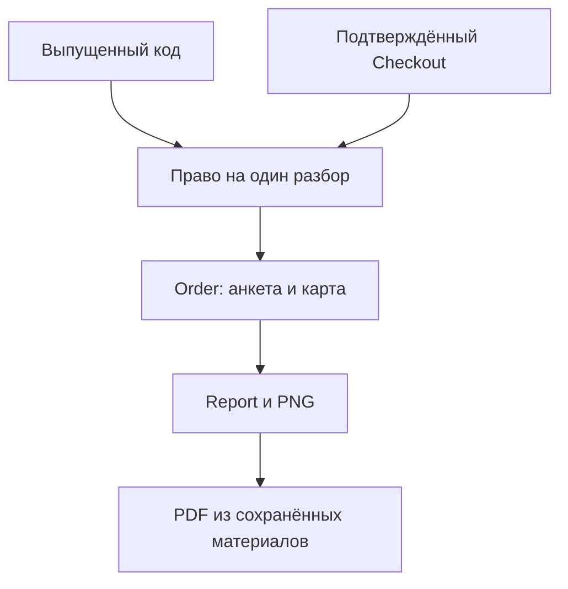
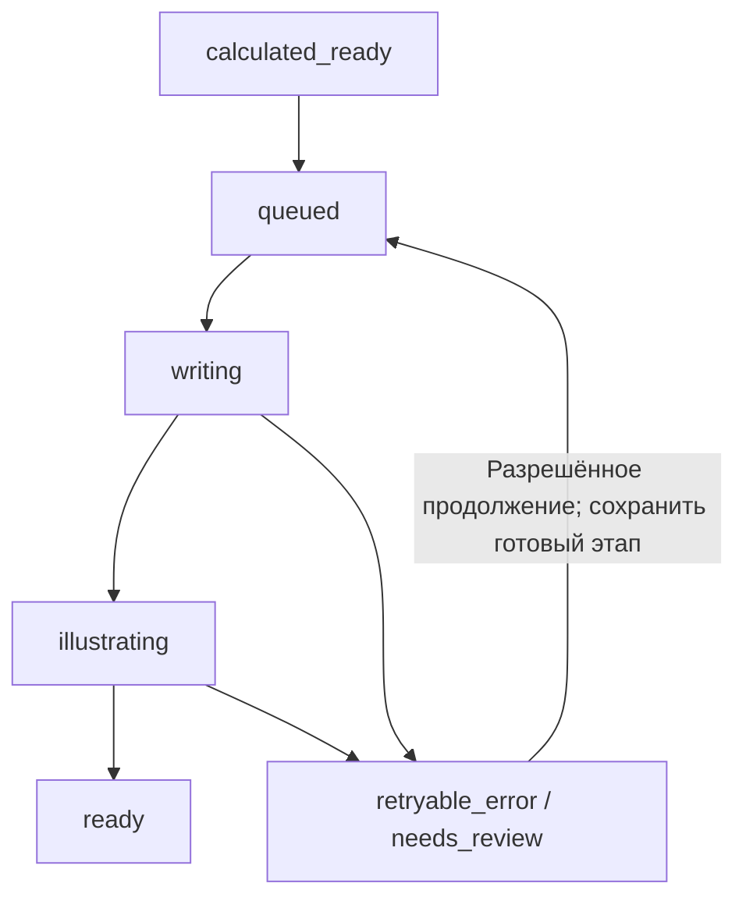

# Личный космос: функциональность сервера

Дата анализа: **10.11.2026**. База описания: исходники **0.13.4** из проверенного архива. Редакция 2: только сервер самостоятельного сайта. Это описание существующей реализации выбранного контура; исходный архив может содержать дополнительные компоненты. Активные настройки и состояние рабочего сервера не исследовались.

## 1. Ответственность сервера

Сервер управляет идентичностью пользователя, правом на одну услугу, созданием заказа, расчётом карты, платной генерацией, хранением и выдачей результата, оплатами, поддержкой и статистикой. Он является источником истины для сумм, принадлежности объектов, состояния доступа и готовности материалов.

Frontend отображает данные и собирает ввод. Признак оплаты, право на генерацию, владельца заказа, координаты места и итоговую стоимость frontend назначать не может.

### Исполняемые компоненты

| Компонент | Функция | Точка входа |
|---|---|---|
| API | HTTP, статический Vue-интерфейс, бизнес-операции, локальный расчёт, worker генерации, сборка PDF, очистка статистики | `cmd/api/main.go:23` |
| Maintenance CLI | Технические операции со старым форматом данных и служебные проверки; возможности конкретной команды проверяются отдельно | `cmd/migrate/main.go:17` |
| PostgreSQL | Основные данные, финансовые записи, очереди/аренды, роли и контроль конкурентности | `internal/app/postgres.go:23` |
| Caddy | HTTPS, внешний вход и reverse proxy к API | `deploy/russia/Caddyfile`, `deploy/russia/compose.yaml` |
| Серверные Python-инструменты | Полные копии, проверка архивов, обновление, восстановление после прерывания, перенос на другой VPS | `deploy/operations/*`, `deploy/russia/*` |

Описываемый режим — `APP_MODE=web`; `AccountsEnabled` в executable API включается для него автоматически. Компоненты выше образуют веб-контур. Это перечень функций, а не утверждение, что существующие Compose-файлы уже сокращены до этого состава.

Production-хранилище — PostgreSQL. `FileStore` с JSON-файлом предусмотрен для локальной демонстрации и разрешён executable только при `ALLOW_DEMO_AUTH=true`. Это не резервная production-БД и не подходящее хранилище реальных банковских операций.

## 2. Доменные сущности и их связь

| Сущность | Значение |
|---|---|
| `Profile` | Введённые имя, дата, время/неизвестность, источник времени, погрешность, ID места |
| `City` | Проверенная сервером подпись, координаты и IANA timezone |
| `Account` | Почтовая идентичность; email уникален, есть признак активности |
| `AccountAccess` | Одно право на продукт в почтовом аккаунте; отдельный черновик и не более одного заказа |
| `Batch` / `Entry` | Партия и конкретный код инвентаря владельца |
| `Checkout` | Банковская операция покупки от 1 до 5 разборов; сумма и условия фиксируются |
| `Order` | Один сохранённый профиль, карта и материалы разбора |
| `Chart` | Версионированный результат локального вычисления |
| `Report` | Текст и его основания, вопросы, художественная концепция и символы |
| `Generation` | Этап выполнения, доступность продолжения, неопределённость, число запусков и временные отметки |
| `WebTicket` | Сохранённый веб-вопрос и поле ответа |



Диаграмма отражает логическую модель. Банковская покупка выдаёт `AccountAccess`; код без почтового кабинета может создать `Order` напрямую. Эти пути сходятся на одной модели заказа и генерации.

## 3. Идентичности, сессии и разрешения

### Типы внутренних идентификаторов

| Префикс | Откуда берётся | Назначение |
|---|---|---|
| `acct:<32 hex>` | Успешная проверка почты | Кабинет сайта |
| `web:<64 hex>` | HMAC действующего кода | Старый вход сайта по коду |
| `owner:<32 hex>` | Серверная настройка владельца сайта | Административный доступ через отдельный ключ |
| `demo:<random id>` | Только явно включённый demo-режим | Локальная демонстрация |

Почтовая и кодовая идентичности различаются. Предусмотрена явная привязка кода и перенос его результата в кабинет; автоматического объединения всех сессий человека нет.

### Сессия

Сессия — подписанный HMAC-SHA256 payload с пользователем и сроком 24 часа. Передача: `Authorization: Bearer <token>` либо cookie `natal_session`. Cookie имеет `HttpOnly`, `SameSite=Strict`, путь `/api`, а при HTTPS — `Secure`.

Это не серверная таблица refresh/access-токенов. `/api/logout` удаляет cookie в браузере; глобального реестра отзыва всех ранее выданных bearer-токенов нет. При каждом защищённом запросе дополнительно проверяется активность почтового аккаунта либо актуальность кодового доступа, а административные операции проверяют действующую роль владельца в БД.

В web-режиме `/api/session` принимает `{}`, восстанавливает допустимый вход из cookie и выдаёт метаданные. Публичному посетителю он не создаёт аккаунт автоматически.

Право владельца не следует из имени, клиентского кода или обычного почтового входа. Владелец не получает через существующие клиентские endpoints универсальный просмотр чужих `Order`: там сохраняется проверка владельца результата.

Для совместной работы команды важно: отдельных административных почтовых аккаунтов и панели управления ролями пока нет. Web-вход использует одну настроенную пару `WEB_OWNER_KEY_HASH` / `WEB_OWNER_USER`. Двух независимых административных почтовых входов и самостоятельной роли оператора веб-поддержки пока нет; для разграничения действий участников команды нужна отдельная доработка.

Основания: `internal/app/auth.go:29`, `internal/app/server.go:279`, `internal/app/web.go:24`, `internal/app/codes.go:16`.

### Общие ограничения HTTP

- Записывающие запросы `/api/*` требуют точного `Origin`, кроме доверенного банковского webhook `/api/bank/notification`.
- Обычный JSON ограничен 16 KiB; неизвестные поля и несколько JSON-значений отклоняются. Статистика имеет более узкий лимит 4 KiB, банковское уведомление — отдельный лимит 64 KiB.
- Ошибка обычно возвращается как `{"error":"понятное сообщение"}`. `400` — ввод, `401` — вход, `403` — роль/Origin, `404` — недоступный объект, `409` — состояние/конфликт, `429` — частота, `503` — временная недоступность. Часть прежних обработчиков использует `500`.
- Стандартные заголовки запрещают кэширование API, MIME-sniffing и отправку referrer. Для HTML устанавливается CSP; в web-режиме встраивание страницы запрещено.
- Значительная часть ограничений частоты находится в памяти конкретного API-процесса. Ограничения OTP по email/IP и данные финансовых операций сохраняются в PostgreSQL.

## 4. Почтовый вход и кабинет

`POST /api/account/login/request` принимает email. Сервер приводит его к нижнему регистру, проверяет формат, длину до 254 байт и латинское написание. Генерирует шестизначный криптографический код и challenge ID. В БД сохраняется HMAC кода, а не сам код; IP используется через отдельный HMAC.

Ограничения на 10 минут: 3 письма на адрес, 50 на IP-хэш, 500 суммарно. Удаляются старые challenge за пределами срока, предусмотренного реализацией. Код действует 10 минут, допускает 5 попыток и потребляется атомарно под блокировкой строки. Неудачная отправка помечает challenge использованным; сессия не выдаётся.

Повторное подтверждение того же email возвращает прежний аккаунт через уникальность email. Неактивный аккаунт не получает рабочий вход. Отправка требует настроенного SMTP; поддерживаются проверяемый TLS для 465 и обязательный STARTTLS для 587.

Кабинет собирается из собственных доступов, собственных `Order` и собственных `Checkout`. Список доступов ограничен 500 записями; список банковских покупок — 100 последними. Пагинации этих списков в API нет.

### Привязка кода к аккаунту

Код должен принадлежать продукту `natal_full_v1`, быть `issued`/`activated`, а его партия — `web_enabled=true`.

- Повтор того же кода тем же аккаунтом возвращает прежний доступ.
- Уже привязанный другому аккаунту код отклоняется.
- Неиспользованный код создаёт доступ `available`, не новый `Order`.
- Использованный кодовый заказ можно перенести с `web:<hash>` на аккаунт с тем же ID заказа и файлами. Запрещён перенос во время `queued/writing/illustrating`.
- При переносе обновляются принадлежность заказа, служебная связь `access_codes`, инвентарь и сохранённые веб-обращения; подходящий черновик переносится, прежний удаляется.
- Старый кодовый вход после переноса больше не авторизует этот результат.

Состояния права в кабинете: `available`, `used`, `blocked`. Отображаемый статус дополнительно учитывает блокировку исходного кода или состояние банковского checkout.

Основания: `internal/app/account.go`, `internal/app/account_http.go`, `internal/app/account_postgres.go:145`.

## 5. Места рождения, анкета и астрономический расчёт

### Справочник

GeoNames встроен read-only в API, содержит 565 273 места и компактный поисковый индекс. Поиск не отправляет ввод внешнему геокодеру, возвращает до 20 вариантов, поддерживает варианты названий, нормализацию регистра/акцентов/«ё» и отдельные исторические имена. Сохранены семь прежних ID мест для совместимости старых заказов.

Клиент передаёт `city_id`. Сервер заново получает координаты и timezone по своему справочнику. При отсутствии места нет молчаливой подстановки соседнего города или timezone. Поиск и восстановление места совместно ограничены 120 запросами в минуту на идентичность.

### Валидация `Profile`

| Поле | Правило |
|---|---|
| `name` | После trim 1–60 Unicode-символов; управляющие символы запрещены |
| `birth_date` | Формат `YYYY-MM-DD`, год от 1900, не позже текущей московской даты |
| `city_id` | Существующий ID справочника |
| `time_unknown` | При true время очищается, source становится `unknown`, accuracy — 0 |
| `birth_time` | При известном времени точный формат `HH:MM` |
| `time_source` | `document`, `family`, `approximate` для известного времени |
| `accuracy_minutes` | 0, 15, 30 или 60 |

Историческая IANA tzdata находится в бинарнике. Повторившееся/несуществовавшее местное время при переводе часов не принимается как однозначное. Ноль в accuracy означает, что погрешность не задана; это не доказательство абсолютной точности времени.

### Расчёт

Движок — Astronomy Engine 2.1.19, выполняемый через Goja внутри Go. Отдельный Node/Python-процесс на VPS и платный астрономический API не нужны. Схема сохранённой карты — `natal-v1`.

Рассчитываются 10 тел: Солнце, Луна, Меркурий, Венера, Марс, Юпитер, Сатурн, Уран, Нептун, Плутон. Система — тропический зодиак, геоцентрические видимые положения. Сохраняются долготы, знак, возможные знаки, скорость и характер движения. Дома — Плацидус; при известных данных также ASC/MC/DSC/IC.

| Аспект | Угол | Орбис |
|---|---:|---:|
| Соединение | 0° | 8° |
| Секстиль | 60° | 4° |
| Квадрат | 90° | 6° |
| Трин | 120° | 6° |
| Оппозиция | 180° | 8° |

Аспекты считаются между этими телами, без фиктивных точек и без аспектов к углам. При диапазоне времени сохраняются только устойчивые на исследованных срезах аспекты. Есть запас у границ знаков 0.02° и предупреждения о неопределённости. Это выбранные правила продукта; они не являются универсальным стандартом всех астрологических программ.

Режимы карты: `known`, `range`, `unknown`. Для unknown рассматривается реальный местный день, включая дни 23/25 часов; опорная середина дня не объявляется временем рождения. `birth_utc`, углы и дома не формируются. При невозможности вычислить Плацидус дома не заменяются другой системой.

Локальные вычисления ограничены контекстом и 30 секундами; предусмотрены два экземпляра интерпретатора. При ошибке вычисления доступ не расходуется. Сохранённые карты при чтении заново не вычисляются.

Основания: `internal/app/model.go:63`, `internal/places/catalog.go`, `internal/astro/engine.go`, `internal/astro/chart.go:150`, `internal/astro/aspects.go`.

## 6. Реестр кодов владельца

### Создание и состояния

Партия создаётся владельцем с названием 1–80 символов, продуктом `natal_full_v1` и количеством 1–500. `Idempotency-Key` и fingerprint параметров предотвращают создание второй партии повтором запроса. Названия партий могут совпадать.

Коды имеют 128 бит случайности. В БД хранятся HMAC для поиска, маска для списка и шифротекст для раскрытия/экспорта. Шифрование — AES-256-GCM с отдельным случайным nonce и привязкой к ID кода, партии и продукту. Отпечатки ключей сверяются с БД; несовпадение не исправляется созданием нового ключа поверх существующего инвентаря.

| Состояние кода | Значение | Основные переходы |
|---|---|---|
| `prepared` | Создан, ещё не выпущен для сайта | `issued` при явном разрешении партии либо `blocked` |
| `issued` | Выпущен; до использования может быть закреплён за аккаунтом | `activated` при создании заказа либо `blocked` |
| `activated` | Связан с конкретным заказом | Штатной кнопки повторного использования/разблокировки нет |
| `blocked` | Дальнейшая активация закрыта | Обратного публичного перехода нет |
| `legacy_unused` | Представление прежнего HMAC-кода в поиске | Не является состоянием новой строки инвентаря |

`EnableWebBatch` выставляет партии `web_enabled=true` и переводит её `prepared` в `issued`. Установка новой версии сама по себе партию не выпускает. Значение source `ozon` в инвентаре — классификация/задел для интеграции, а не доказательство получения кода реальным заказом Ozon.

### Действия владельца

- Сводка, список партий, поиск по коду/маске/партии/номеру заказа; фильтры статуса и источника, offset и limit до 100.
- Раскрытие полного нового кода с записью в аудит. Старый HMAC-only код расшифровать нельзя.
- Блокировка конкретного `prepared` или `issued` кода либо таких кодов в партии; нужна причина 3–300 символов. Блокировка аннулирует прежние CSV-выгрузки партии.
- Создание CSV с кодами `prepared`/`issued`, BOM UTF-8, разделителем `;` и защитой ячеек от интерпретации как Excel-формул.
- Зашифрованный CSV и короткая ссылка на 5 минут; при скачивании заново проверяются право владельца, срок и доступность выгрузки. Ссылка не является API-сессией.
- Журнал последних 30 событий. Полные коды и полный поисковый ввод в аудит не пишутся.

Для восстановления нужны база и соответствующие `CODE_SECRET`/`CODE_VAULT_KEY`. Операции с зашифрованными значениями при ошибке ключа закрываются; это не должно автоматически останавливать весь клиентский сайт.

Основания: `internal/accesscodes/service.go`, `internal/accesscodes/crypto.go`, `internal/accesscodes/export.go`, `internal/accesscodes/web.go`, `internal/app/codes.go`.

## 7. Заказ, использование доступа и идемпотентность

`Order` сохраняет ID, внутреннего владельца, кодовую/покупочную связь, fingerprint анкеты, продукт/доступ, профиль, место, `Chart`, `Report`, статус и `Generation`.

`UserID`, `CodeHash`, `IdempotencyKey` и `Fingerprint` не включаются непосредственно в JSON клиента. В БД они сохраняются вместе с сериализованным заказом. В веб-контуре связи `AccessID` и `ProductID` показывают использованный доступ и продукт; кодовая принадлежность хранится отдельно.

| Входной сценарий | Создание | Транзакционная граница |
|---|---|---|
| Код сайта | `POST /api/orders` после кодового входа | Инвентарь, служебный `access_codes`, заказ и состояние активации |
| Услуга кабинета | `POST /api/account/access/{id}/orders` | Проверить право/источник, сохранить заказ, отметить доступ used, убрать черновик |

Заголовок `Idempotency-Key` для заказа: 16–80 латинских букв, цифр, `_`/`-`. Ключ scoped по владельцу. База защищает уникальность кода у заказа и `(user_id,idempotency_key)`. Дополнительно сравниваются fingerprint анкеты и связь доступа.

Повтор с той же анкетой возвращает существующий результат; попытка поменять анкету по использованному праву — `409`. Заказ сохраняет исходные данные, а не редактируемую ссылку на текущий черновик. Расчёт выполняется до списания права; конкурентность контролируется транзакциями и блокировками.

Порядок блокировок для кодовых аккаунтов: инвентарь → доступ → заказ. Для банковского доступа: checkout → доступ → служебный код/заказ. Эти порядки используются и при обработке оплаты/возврата; их изменение требует проверки гонок.

## 8. Фоновая генерация и восстановление

### Где находится очередь

Встроенный `generationWorker` работает в API-процессе. Состояние сохраняется в заказах. Worker последовательно выполняет queued-заказы; проверка очереди — каждые 2 секунды и по внутреннему уведомлению. Выборка PostgreSQL ограничена 100 активными заказами за проход, по времени создания.

При запуске worker захватывает PostgreSQL advisory lock на закреплённом соединении; второй API с генератором не стартует на той же БД. Для FileStore — файловый flock. Это намеренно **один worker**, а не готовая распределённая очередь. Отдельного Redis/RabbitMQ/Kafka в архитектуре нет.

### Состояния

| `Order.status` | Значение |
|---|---|
| `demo_ready` | Исторический демонстрационный результат без полноценного расчёта |
| `calculated_ready` | Карта сохранена, полного ИИ-результата ещё нет |
| `queued` | Генерация поставлена в очередь |
| `writing` | Выполняется текстовый этап / допустимая доработка |
| `illustrating` | Текст принят, выполняется изображение |
| `ready` | Принятый текст и изображение готовы |
| `retryable_error` | Сохранена ошибка с известным исходом; возможность продолжения дополнительно задаётся `Retryable` |
| `needs_review` | Неопределённый исход или остановка для проверки |

`Report.kind` — отдельное измерение: `demo`, `calculated`, `generated`. Например, при ошибке изображения у заказа может быть `needs_review`, а у текста уже `kind=generated`.



### Правила выполнения

1. Проверить владельца, конкретное право на заказ и актуальное согласие.
2. Повторный запуск готового/активного заказа не создаёт второй worker для него.
3. Перед каждым платным этапом снова проверить источник доступа: аккаунт и его доступ, действующий код либо явно разрешённый демонстрационный режим.
4. Найти и валидировать сохранённый текст; при его наличии не вызывать текстовую модель заново.
5. Получить отсутствующий текст, записать его приватно и атомарно, обновить заказ.
6. Проверить сохранённый PNG; при его наличии не вызывать модель изображения.
7. Записать изображение, затем завершить состояние `ready`.

Число пользовательских запусков ограничено пятью; это **не** бюджет на пять автоматических платных повторов. Для сайта и почтового кабинета `Uncertain=true` запрещает клиентское продолжение даже при передаче `acknowledge_repeat=true`. Кнопка в браузере не снимает эту проверку.

При рестарте queued-заказы продолжаются. Прерванные writing/illustrating сопоставляются с checkpoint и PNG. Полностью сохранённые результаты восстанавливаются без HTTP к ИИ; подтверждённый текст может продолжить изображение. Если завершённость платного вызова не доказана, выставляется `needs_review`. Полный валидный короткий черновик может пройти предусмотренный ограниченный путь доработки, если резервация ещё не израсходована.

Основания: `internal/app/generation.go:32`, `internal/app/generation.go:71`, `internal/app/generation.go:188`, `internal/app/generation.go:271`, `internal/app/postgres.go:239`.

## 9. ИИ: вход, контракт, доработка, ошибки

### Фиксированные провайдеры

| `AI_PROVIDER` | API origin | Ключ |
|---|---|---|
| `openai` или значение по умолчанию | `https://api.openai.com/v1` | `OPENAI_API_KEY` |
| `aitunnel` | `https://api.aitunnel.ru/v1` | `AITUNNEL_API_KEY` |
| `aitunnel-ru` | `https://ru-api.aitunnel.ru/v1` | `AITUNNEL_API_KEY` |

Произвольный URL из env не поддерживается. Редиректы HTTP запрещены, автоматического переключения на другой endpoint/провайдера нет. Прямой OpenAI использует `/responses`, AITUNNEL — адаптацию к `/chat/completions` со строгой JSON Schema. Запрос текста — `store=false`, без stream.

По умолчанию текстовая модель — `gpt-4.1`. Изображение: для прямого OpenAI — `gpt-image-1.5`, для AITUNNEL — **`gpt-image-2`**. Модели можно переопределить через `OPENAI_TEXT_MODEL`/`OPENAI_IMAGE_MODEL`; доступность конкретной модели не проверяется каждым клиентским запросом заранее.

### Что передаётся поставщику

`readingFacts` формирует версию контракта, режим/точность/источник времени, предупреждения и словарь допустимых показателей. Передаются доступные знаки/диапазоны знаков, подходящие дома, ретроградность, ASC/MC при допустимом времени и устойчивые аспекты.

Имя, email, исходные календарные дата и время, город, координаты, код доступа, идентификатор аккаунта и текст обращения поддержки в этот input не входят. Изображение строится по художественной концепции и символам принятого разбора. `safety_identifier` с хэшем заказа отправляется только прямому OpenAI; в AITUNNEL-запросе он удаляется.

Это описание состава запросов из кода. Юридическая анонимизация или полная локализация обработки из него не следуют.

### Контракт текста

Основная схема требует summary, восемь разделов, вопросы, visual_concept и 3–5 символов. Разделы имеют фиксированные ключи и порядок:

```text
overview, character, emotions, communication,
relationships, work, challenges, integration
```

В основной схеме по 3 абзаца на раздел; инструкции задают ориентир 80–95 слов на абзац и 2100–2500 слов суммарно. После дополнения допустимы 3–5 абзацев в разделе.

Самостоятельный серверный валидатор проверяет:

- корректный единственный JSON без неизвестных/лишних полей;
- восемь разделов в нужном порядке, непустые заголовки и 3–5 абзацев;
- 5–8 вопросов и 3–5 символов;
- ссылки каждого раздела и символа только на известные ID рассчитанных показателей;
- минимум 95 слов в тексте раздела и 65 в художественной концепции при полной проверке;
- **1800–2700 слов** в summary + названиях/текстах разделов + вопросах;
- отсутствие длинных серий пробелов и ряда явно нерассчитанных точек: Лилит, Хирон, лунные узлы.

Слова считаются по Unicode-буквам и цифрам; знаки пунктуации не увеличивают объём. Проверка ссылок и запрещённых точек не является полным доказательством истинности каждого предложения ИИ. Часть содержательных ограничений задаётся инструкцией модели.

### Короткий ответ

Доработка разрешена только для полностью полученного ответа, прошедшего структурные и остальные проверки, с допустимой проблемой объёма. Неполный JSON, refusal, padding и неизвестный исход не превращаются в новый платный запрос ради «починки».

Для AITUNNEL при общем `reading_short` сервер запрашивает новые абзацы для отдельных разделов, сохраняет старые, проверяет источники/дубли и итоговый контракт. План дополнения ориентирован примерно на 2100 слов. Остальные допустимые короткие ответы используют ограниченную редакционную доработку полного JSON.

Перед доработкой создаётся файловая резервация с `O_EXCL`, синхронизацией на диск, моделью, исходным input и SHA-256 черновика. Существующая незавершённая резервация запрещает повтор. Старые `reading-repair.json`/`reading-length.json` учитываются; новая генерация не должна обходить их удалением или созданием другого исходного запроса.

### Классификация отказов

| Событие | Поведение |
|---|---|
| Явный 401/403 | Пауза; проверить ключ/модель, не считать успехом |
| Явный 402 / исчерпание бюджета | Пауза; право и материалы сохраняются |
| 400/404/422 | Пауза с безопасным сообщением о параметрах; отдельно распознаётся `pii_blocked` |
| Явный 429 | Один ограниченный повтор через 3 секунды, кроме `insufficient_quota` |
| Таймаут, обрыв, 5xx, неполное успешное тело | Неизвестный исход; автоматический повтор запрещён |
| `finish_reason` не stop / incomplete / refusal | Не принимается как готовый разбор |
| Запись результата на диск не удалась | Остановка для проверки; оплаченный результат мог уже существовать у поставщика |

Полный текстовый запрос ограничен 14000 выходных токенов; AITUNNEL — 6 минут, прямой OpenAI — 4 минуты. Дополнение использует лимит 8000 токенов. Изображение запрашивается один раз за этап: `n=1`, 1024×1536, medium, PNG, opaque; принимается один корректно декодируемый base64 PNG, а не ссылка на сторонний файл.

### Приватные файлы генерации

В каталоге заказа сохраняются `reading-response.json`, `reading.json`, при необходимости `reading-repair.json`, `reading-length.json`, `reading-expansion.json`, `illustration.png` и content-addressed PDF. Не все файлы есть у каждого заказа. Полные ответы не публикуются как одобренный текст до валидации. Права записи — приватные, файлы фиксируются через временный файл и rename.

Основания: `internal/app/openai.go`, `internal/app/ai_provider.go`, `internal/app/generation_prompt.go`, `internal/app/reading_checkpoint.go`, `internal/app/reading_repair.go`, `internal/app/reading_expansion.go`.

## 10. PDF, TXT, PNG и ссылки скачивания

TXT составляется из сохранённого `Report` и доступен при `kind=generated`, даже если изображение ещё не завершилось. PNG требует `Generation.ImageReady` и существующий файл. SVG endpoint отдаёт демонстрационную графику; он не заменяет персональный PNG.

PDF строится локально через `fpdf`, используя встроенные шрифты и сохранённые профиль, место, карту, текст и PNG. Он содержит обложку, пояснения, круг/таблицы карты, разделы, вопросы, художественный образ и подписи символов. В нём нет вызова ИИ или повторного расчёта карты.

Файл называется `report-<content hash>.pdf`; хэш зависит от версии шаблона, профиля, места, карты, текста и байтов изображения. Он не зависит от mutable timestamps генерации или private identity. Одновременная сборка одного файла объединяется через singleflight.

`POST /api/orders/{id}/download` выдаёт capability-ссылку на выбранный `report.txt`, `report.pdf` или `illustration.png` на 5 минут. В ней подписаны пользователь, заказ, формат и срок, а не полноценная сессия API. GET/HEAD можно повторять до истечения срока; при скачивании проверяется принадлежность заказа. Ограниченный endpoint загрузки поддерживает OPTIONS и CORS-заголовки. Основной веб-интерфейс скачивает файлы напрямую с текущей сессией; выдача ticket сама по себе не запускает ИИ.

Проверка обычных файлов/ID ограничивает выбор имён и путь к файлам. Содержимое PDF трактуется как текст, не исполняемый HTML.

Основания: `internal/app/pdf.go:35`, `internal/app/pdf.go:55`, `internal/app/download.go:17`.

## 11. Банковская покупка сайта

### Готовность продаж

Для новых продаж нужны: `ShopConfig.Enabled`, положительная серверная цена, сведения о продавце/поддержке, версия и HTTPS-ссылки условий/политики, фискальные параметры и подтверждённая готовность чеков, HTTPS-домен, настроенный почтовый вход, генератор, банк live и `BANK_LAUNCH_APPROVED=true`.

Это технические проверки заполнения и конфигурации; они не подтверждают фактическую доставку писем, качество правовых документов или реальные банковские расчёты.

`GET /api/shop` сообщает `sales_ready`. Для определения доступности банковской покупки нужен именно этот контракт; общие поля `payments_available/payments_enabled` веб-сессии не являются индикатором готовности банка.

### Корзина и checkout

Сервер принимает только product ID и количество, поддерживает `natal_full_v1` и суммарно до 5 разборов. Цена хранится целым числом копеек, допустимо до 100000 рублей за услугу. Quote содержит позиции, total, RUB, revision и terms_version.

Оформление требует почтового аккаунта, Idempotency-Key, актуальных revision/terms_version и `accept_terms=true`. В checkout фиксируются цена/позиции, email для чека, принятые документы, terminal и test/live. Смена цены не изменяет уже сохранённую покупку.

Повтор ключа возвращает тот же checkout; новый ключ для той же незавершённой корзины переиспользует операцию. Пока есть другая незавершённая корзина, новая отклоняется. Неопределённый результат банковского Init переводит операцию в review вместо повторного открытия другого платежа.

### Адаптер и подтверждение

Реализован интерфейс `sitepay.Bank` и адаптер Т-Банка: Init, GetState, проверка Token уведомления. Платёжная форма размещена на стороне банка; приложение не принимает номера карт. URL оплаты проверяется по HTTPS и разрешённым банковским хостам. Notification не требует пользовательской сессии/Origin, но требует корректной подписи и соответствия заказа/терминала/платежа/суммы. При CONFIRMED дополнительно запрашивается состояние в банке.

Статусы checkout: `initializing`, `pending`, `paid`, `failed`, `review`, `refunded`. AUTHORIZED ещё не выдаёт услугу; доступ появляется после CONFIRMED. В одной транзакции создаётся отдельный `AccountAccess` на каждую купленную единицу. Дубли уведомлений не должны создавать новые права.

Обновить состояние может покупатель своего checkout; владелец может выполнить reconcile, в том числе указать известный payment ID для операции с неизвестным исходом. Автоматического поиска неизвестного payment ID через CheckOrder нет.

Уведомление полного возврата блокирует связанные доступы. Частичный возврат переводит покупку в review и также блокирует дальнейшее использование до разбора. Вызова банковского API для инициирования возврата из интерфейса проекта нет. Подписки, рекуррентные списания и эквайринг Ozon Банка не реализованы.

Основания: `internal/app/shop.go`, `internal/app/shop_http.go`, `internal/app/shop_postgres.go`, `internal/sitepay/bank.go`.

## 12. Веб-поддержка

`GET/POST /api/web/support` позволяют авторизованному пользователю посмотреть свои обращения и создать вопрос 5–3000 символов с необязательным собственным `order_id`. Для отправки нужен `Idempotency-Key`; повтор того же тела с тем же ключом возвращает прежнее обращение, другое тело конфликтует. Лимит создания — 5 обращений в минуту на идентичность API-процесса.

`GET /api/admin/web-support` и `POST /api/admin/web-support/{id}/reply` доступны владельцу. Ответ — 1–5000 символов. Чужой заказ нельзя прикрепить к клиентскому обращению.

В модели один `message` и один `reply`, а не произвольная история переписки. Повтор ответа заменяет поле `reply`. Ответ читается на сайте; отправки email, push и вложений нет. Без входа форма вопрос не сохраняет. Отдельной роли оператора, очереди доставки сообщений и SLA в этом веб-механизме нет.

Показ формы зависит от frontend-сборки: при выбранном внешнем контакте форма скрыта. Для сценариев данного пакета необходимо выбрать именно веб-форму; это существующая ветвь `WebSupport.vue`, а не подтверждённая текущая настройка production. Отсутствует самостоятельный путь обращения для человека, который не может пройти ни почтовый, ни кодовый вход.

После явного переноса кодового заказа в почтовый кабинет сервер также переносит связанные веб-обращения. Сама смена сессии между двумя идентичностями без привязки кода их не объединяет.

Основания: `internal/app/web_support.go`, `internal/app/web_support_store.go`, `frontend/src/WebSupport.vue`.

## 13. Статистика сайта

### Посещения

Browser-клиент отправляет событие только после согласия. Выбор хранится 90 дней; отказ/DNT/GPC прекращают отправку. Визит обновляется после 30 минут без открытия экранов. Это логика frontend, а не доказательство количества физических людей.

Сервер принимает фиксированные page/source/device, случайные event/visitor/visit ID и consent=true. Он сохраняет только HMAC идентификаторов, разрешённые категории и серверное время. IP, User-Agent, полные URL, email, данные рождения, код и order_id в эту таблицу не записываются.

Повтор event дедуплицируется. Известные bot/spider/crawler/preview User-Agent, DNT/GPC и текущий владелец исключаются. Лимиты: 600 событий в минуту суммарно и 60 на visitor-хэш. Это операционная аналитика, не защищённый от подделки финансовый счётчик.

События старше последних 90 московских календарных дней удаляются при запуске API, при следующем событии и почасовой очистке. Аккаунты, заказы и уже созданные полные резервные копии этой очисткой не удаляются.

### Отчёт владельца

Периоды: 1, 7, 30, 90 дней, включая текущий неполный день; timezone — Europe/Moscow. Возвращаются visitor/visit/view, общее число аккаунтов, регистрации периода, количество разборов по состояниям, дневной ряд и top-10 страниц/источников/устройств.

Регистрация — создание подтверждённого почтового аккаунта; кодовый вход не считается регистрацией. Статистика разборов учитывает web/acct заказы периода создания и их **текущее**, а не историческое состояние. Источники/устройства считаются по просмотрам. Конверсия из неполной по согласию посещаемости в полные регистрации не рассчитывается.

Основания: `internal/app/statistics.go`, `internal/app/statistics_postgres.go`, `frontend/src/site-statistics.ts`.

## 14. Данные и хранение

### SQL-схема веб-контура: 20 таблиц

Это выбранные таблицы, используемые описанными функциями сайта. Перечень не является миграцией удаления остальных схем исходного архива.

| Подсистема | Таблицы | Что хранится |
|---|---|---|
| Ядро | `access_codes`, `drafts`, `orders` | Прежний реестр использования прав, черновики, неизменяемые анкеты и JSONB-заказы |
| Почтовый кабинет | `cosmos_accounts`, `cosmos_email_challenges`, `cosmos_account_access`, `cosmos_account_drafts` | Аккаунты, OTP/лимиты, права на продукт, отдельные анкеты |
| Веб-вопросы | `cosmos_web_tickets` | Вопрос, ответ и принадлежность |
| Продажи сайта | `cosmos_shop_config`, `cosmos_checkouts`, `cosmos_site_grants`, `cosmos_shop_audit` | Настройки, банковские операции, выданные права, аудит |
| Посещения | `cosmos_site_statistics`, `cosmos_site_pageviews` | Начало сбора и обезличенные в рамках реализации события |
| Кодовый реестр | `cosmos_code_config`, `cosmos_code_owners`, `cosmos_code_batches`, `cosmos_code_inventory`, `cosmos_code_audit`, `cosmos_code_exports` | Отпечатки ключей, роли, партии/коды, события и зашифрованные CSV |

`orders.payload` содержит `StoredOrder`, в том числе собственно `Order` с вложенными Chart/Report/Generation. Текущий статус выбирается из JSONB, а не из отдельной status-колонки `orders`.

Большие генерируемые файлы находятся на файловом томе `GENERATED_ASSET_DIR`, а не целиком в SQL. База и файловый том составляют единый восстанавливаемый комплект. PDF, чтение и PNG обслуживаются только через контролируемые обработчики, каталог generated не объявлен публичной static-директорией.

Пул API: max 4 соединения, idle 2; генератор удерживает одно соединение для advisory lock. SQL-изменения и фоновые процессы надо проектировать с учётом этих небольших лимитов.

Основания: `internal/app/schema.sql` и `internal/accesscodes/schema.sql`, `internal/app/postgres.go`, `internal/app/model.go:161`, `deploy/russia/compose.yaml`.

## 15. Конфигурация и режимы

Ниже указаны **названия переменных**, без реальных значений секретов.

| Группа | Основные переменные | Назначение |
|---|---|---|
| HTTP/режим | `APP_MODE`, `APP_ADDR`, `APP_ORIGIN`, `PUBLIC_APP_URL`, `STATIC_DIR` | Режим web, listen, доверенный origin и интерфейс |
| Хранилище | `DATABASE_URL`, `STATE_PATH`, `GENERATED_ASSET_DIR` | PostgreSQL, demo JSON, файлы результатов |
| Идентичность | `SESSION_SECRET`, `CODE_SECRET`, `WEB_OWNER_KEY_HASH`, `WEB_OWNER_USER` | Подписи, HMAC кодов и отдельный вход владельца |
| Инвентарь | `CODE_VAULT_KEY` | Независимое шифрование новых кодов/экспортов |
| Демонстрация | `ALLOW_DEMO_AUTH`, `DEMO_GENERATION` | Разрешить только явно локальную имитацию |
| ИИ | `ENABLE_AI_GENERATION`, `AI_PROVIDER`, `OPENAI_API_KEY`, `AITUNNEL_API_KEY`, `OPENAI_TEXT_MODEL`, `OPENAI_IMAGE_MODEL` | Провайдер, модели и включение генерации |
| Почта | `MAIL_ENABLED`, `MAIL_HOST`, `MAIL_PORT`, `MAIL_USERNAME`, `MAIL_PASSWORD`, `MAIL_FROM` | OTP через SMTP |
| Банк | `TBANK_TERMINAL_KEY`, `TBANK_PASSWORD`, `TBANK_MODE`, `BANK_LAUNCH_APPROVED` | Подготовленный адаптер банка и разрешение live-продаж |
| Пилот | `AI_PILOT_DIR` | Изолированные synthetic-checkpoints provider CLI |

Demo-auth нельзя совмещать с реальным платным генератором. Production требует разные приватные SESSION_SECRET и CODE_SECRET и HTTPS. Для production без DATABASE_URL executable останавливается, а не создаёт тихо локальную БД.

Настройки наличия SMTP/банка в метаданных означают создание соответствующего адаптера. Они не являются сквозным мониторингом доставки/оплаты.

## 16. Развёртывание, копии и миграция

Варианты Compose в `compose.yaml`, `deploy/server/compose.yaml` и `deploy/russia/compose.yaml` различаются. Старый shared-host вариант использует внешнюю proxy-сеть соседнего проекта; новый российский вариант содержит собственный Caddy. Нельзя механически считать их одним конфигом.

В российском варианте API доступен на loopback `18080`, PostgreSQL — в приватной Docker-сети, наружу у Caddy 80/443. Сборка Go/Vue на VPS не требуется: пакет содержит готовый Linux/amd64 runtime и frontend/dist. В Compose заданы ограничения памяти/CPU, ротация логов, read-only API и приватные env-файлы.

### Копии

Инструменты создают полный `pg_dump`, добавляют готовые материалы и приватные настройки, проверяют manifest/SHA-256 и структуру. По предусмотренному расписанию: ежедневно 04:15–04:20 МСК, до 7 копий и общий лимит хранения 512 MiB. Сама проверка/распаковка также ограничивает размер; рост проекта требует пересмотра лимитов.

Отдельный Mac-скрипт может скачивать проверенные копии по ограниченному SSH-ключу. Это внешняя операция, не функция пользовательского HTTP API. Для неё нужны включённый Mac и сеть; серверное копирование не зависит от открытого ноутбука.

При подготовке восстановления генерация отключается. Восстановление должно использовать отдельную пустую БД и согласованный комплект файлов/секретов. Старый JSON export/import не является полным бэкапом новых подсистем и отклоняет неподдерживаемые финансовые/аккаунтные данные.

### Обновление

Инструменты проверяют пакет и права, собирают образ до остановки, откладывают обслуживание при активной генерации/опасном финансовом состоянии, останавливают только компоненты проекта, делают копию, проверяют новую версию и восстанавливают прежнюю конфигурацию при допустимом сбое. Откат бинарника не должен уничтожать новые пользовательские строки в БД.

### Перенос на российский VPS

В пакете предусмотрены отдельные фазы prepare → проверка ИИ/почты → freeze/transfer → restore → DNS → finish. Сравниваются таблицы и файлы; до переключения пользовательских записей прежнее приложение замораживается. Пилот на вымышленных данных отделён от клиентской базы. Перечень сервисов в исходных инструментах необходимо адаптировать к выбранному составу веб-продукта.

**Имеющийся migration-пакет привязан к конкретным адресам исходного/целевого сервера и Ubuntu 26.04 x86_64.** Это не универсальный установщик для любого купленного VPS. Перед новой миграцией его адреса, ОС и условия должны быть адаптированы и проверены. Выбор/покупка нового VPS, завершение прежнего finish и фактическое расписание копий в рамках этого анализа не подтверждались.

### Provider CLI

`provider-format-check` проверяет короткий synthetic-текст, `provider-pilot` — полный текст и изображение, `provider-pilot-resume-short` и `provider-pilot-resume-image` — контролируемое продолжение сохранённого пилота. Они запускаются до инициализации БД, имеют собственные lock/состояния, могут выполнять платные вызовы и не являются обычной кнопкой пользователя. `repair-ai-image` в Mac-оркестраторе относится к такому продолжению пилота.

Основания: `deploy/operations/cosmos_ops.py`, `deploy/operations/lichny-cosmos-backup.timer`, `deploy/russia/cosmos_migrate.py`, `deploy/russia/mac.py`, `cmd/api/main.go:24`.

## 17. Наблюдаемость и ограничения текущей версии

`GET /healthz` отвечает `{"status":"ok"}`. Это лёгкая проверка живого HTTP-процесса, а не сквозная проверка БД, SMTP, баланса ИИ и банковской оплаты. Более глубокие проверки выполняют инструменты установки/эксплуатации и диагностические сценарии.

В приложении есть состояния заказов, аудит инвентаря/магазина, состояния банковских покупок и веб-обращений и безопасные диагностические сообщения. Полные provider-ответы и checkpoint находятся в приватных файлах. В обычные логи не должны попадать промпты, данные рождения, ключи и произвольные сырые ответы поставщиков. Prometheus-метрик, distributed tracing и отдельного сервиса мониторинга в этой версии не обнаружено.

Нет следующих готовых пользовательских возможностей: смена анкеты использованного заказа, отмена активного платного запроса, удаление/экспорт всех персональных данных из кабинета, автоматическая рассылка результата, подписки, банковский refund API, полноценная CMS и распределённое выполнение генерации.

Наличие восстановления checkpoint и идемпотентных операций не означает абсолютное exactly-once во внешних API. Транзакция PostgreSQL не может атомарно охватить платный HTTP-запрос поставщику; поэтому неопределённые исходы выделены в отдельное состояние.

## 18. Точки входа и связанные проверки для следующих задач

| Область | Основные файлы | Проверки в репозитории |
|---|---|---|
| Вход и кабинет | `account*.go`, `web.go`, `auth.go` | `account_test.go`, `web_test.go`, `app_test.go` |
| Коды и активация | `accesscodes/*`, `codes.go`, `web_postgres.go` | `service_test.go`, `codes_test.go`, `account_test.go` |
| Карта/места | `astro/*`, `places/*`, `calculation.go` | `chart_test.go`, `catalog_test.go`, `cities_test.go` |
| Генерация | `generation.go`, `openai.go`, `reading_*` | `generation_test.go`, `reading_validation_test.go`, `reading_length_test.go`, `reading_repair_test.go`, `reading_expansion_test.go` |
| Провайдеры/пилот | `ai_provider.go`, `provider_*` | `ai_provider_test.go`, `provider_format_test.go`, `provider_pilot_image_test.go` |
| Файлы/PDF | `pdf.go`, `download.go` | `pdf_test.go`, `download_test.go` |
| Банковская продажа | `shop*`, `sitepay/bank.go` | `shop_test.go`, `bank_test.go` |
| Веб-поддержка | `web_support*`, `WebSupport.vue` | Проверить изоляцию, идемпотентность, перенос принадлежности и обновление ответа |
| Статистика | `statistics*`, browser consent | `statistics_test.go`; согласие и поведение browser проверяются отдельно |
| Копии/миграция | `deploy/operations`, `deploy/russia` | соответствующие `test_*.py` |

Базовые команды проверки после изменения: `go test ./...`, при поддерживаемом окружении `go test -race ./...`; frontend — `npm ci` и `npm run build` в `frontend`. Часть SQL-сценариев требует `TEST_DATABASE_URL` и без него пропускается: успешный общий запуск без отдельного PostgreSQL не подтверждает конкурентные SQL-сценарии.

Эти команды здесь приведены для следующих задач, **не как выполненный в этой сессии прогон**. Минимальные обязательные сценарии для изменений доступа/оплаты/генерации: чужой объект недоступен; повтор не создаёт второй заказ/доступ; другая анкета конфликтует; ошибка до расчёта не расходует право; сохранённый этап не оплачивается повторно; неизвестный внешний исход не повторяется; возврат закрывает новые этапы; перезапуск сохраняет состояние.

## 19. Приоритет кода над историческими описаниями

В архиве сохранены описания нескольких старых версий. Их отдельные фразы уже не соответствуют 0.13.4:

1. Упоминание «оплаты ещё не подключены» нельзя переносить на отсутствие платёжного кода: адаптеры есть, их коммерческое включение отдельно.
2. Старое «новые коды не активируют доступ» относится к prepared-партиям; в 0.13.4 есть явный выпуск партии для сайта.
3. Старое описание блокировки только prepared-кодов уже возможностей реализации: код позволяет блокировать prepared и issued, пока они не activated.
4. Старые разделы AI_PROVIDER с gpt-image-1.5 для шлюза перекрыты исправлением 0.13.4: для AITUNNEL по умолчанию gpt-image-2.
5. 1800 — **слова** в действующем валидаторе, не символы; схема без счётного regex, который раньше вызывал заполнение пробелами.
6. Расширенный справочник заменил ранний набор из семи городов; legacy ID сохранены лишь для совместимости.
7. Подготовленность миграции не доказывает, что на текущем VPS запущены именно эти режимы.

При доработке сначала проверяйте функцию и тест затронутой подсистемы, затем обновляйте документацию в том же изменении.
