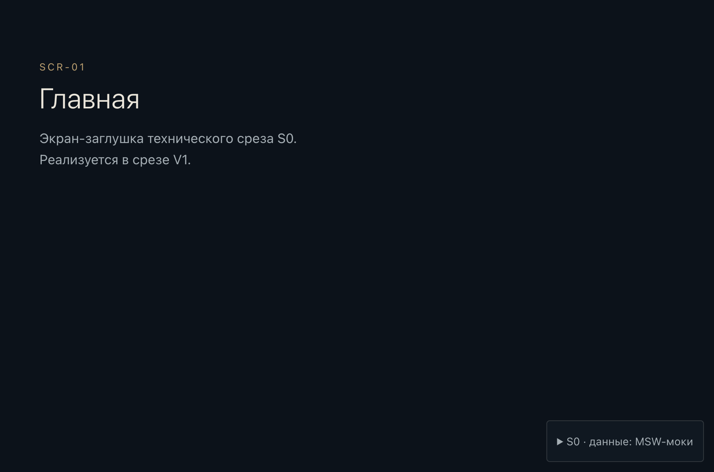

# S0 — отчёт о реализации технического среза

Дата: 2026-11-11. Ветка: `feat/s0-bootstrap` (изменения не закоммичены). Основание: ARCHITECTURE_MVP_v2 §23, утверждение владельца от 2026-11-11.

**Итог.** Все 14 пунктов S0 выполнены, все обязательные проверки проходят локально. Бизнес-логики заказов, кодов и генерации нет, дизайна главной нет, платные API не подключались, production и legacy не затрагивались. К V1 не переходили.



## 1. Что сделано по пунктам задачи

| # | Пункт | Где | Состояние |
|---|---|---|---|
| 1 | Структура монорепозитория по §4 | корень | Готово. Корневые `go.mod` и `main.go` (шаблон IDE) удалены. `PRODUCT.md`, `DESIGN.md`, `.impeccable/` не созданы (см. §5) |
| 2 | Go backend | `backend/` | Один бинарник `cosmos`: `serve`, `migrate up/status`, `version`, `help`. Пакеты всех модулей §5 созданы с `doc.go` без логики |
| 3 | HTTP, health и readiness | `internal/httpapi` | `GET /healthz`, `GET /readyz` (PostgreSQL + отсутствие непримененных миграций, параллельно, с таймаутом), `GET /api/v1/config`. Ошибки RFC 9457, request id, access-лог, recover, заголовки безопасности, лимит тела 16 KiB, graceful shutdown |
| 4 | PostgreSQL и первая миграция | `internal/platform/postgres`, `migrations/` | pgx v5 pool, goose v3 (Provider API, миграции встроены через `embed`). `00001_module_schemas.sql` создаёт только схемы модулей (identity, access, intake, places, orders, generation, artifacts, audit, ops). Таблиц и ограничений нет, атомарное создание заказа не затронуто |
| 5 | Vue 3 + TS + Vite | `frontend/` | TS strict + `noUncheckedIndexedAccess` + `exactOptionalPropertyTypes`, Vite 8 |
| 6 | Роутер и базовые компоненты | `src/app/` | Все маршруты SCR-01…15 с заглушками; фокус на заголовок после навигации, `aria-live`-объявление, skip-link, заголовок документа |
| 7 | CSS-токены | `src/ui/tokens.css` | Значения DESIGN_SYSTEM §4 без изменений; шрифты §5 как гипотезы с системными fallback; motion-токены MOTION_SPEC §3; переопределения для reduced motion |
| 8 | Motion for Vue и Three.js | `src/motion/`, `src/scene/` | `MotionConfig reduced-motion="user"`, `AnimatePresence` вокруг `RouterView`; токены продублированы в TS, их совпадение с CSS проверяется тестом. Three.js загружается динамическим импортом |
| 9 | Оболочка `CosmosCanvas` | `src/scene/` | Один постоянный canvas вне `RouterView`; `SceneDirector`: один renderer и один RAF-цикл, пауза на скрытой вкладке, потеря контекста → fallback, `dispose`; уровни качества high/medium/low/static; композиции — данные; `?scene=freeze` только в dev. Полной сцены нет |
| 10 | MSW | `src/mocks/` | Только `DEV && VITE_API_MOCKS=1`; заголовок `x-cosmos-mock: 1`; dev-панель показывает источник данных; воркер удаляется из `dist`, `check:bundle` это проверяет |
| 11 | OpenAPI и TS-типы | `api/openapi.yaml`, `src/api/` | OpenAPI 3.1; `openapi-typescript` → `schema.d.ts`; клиент `openapi-fetch`; Go-ответы проверяются по спецификации (kin-openapi, только в тестах) |
| 12 | Makefile, линтеры, тесты, CI | `Makefile`, `backend/.golangci.yml`, `.github/workflows/ci.yml` | golangci-lint v2.15.0 с правилами графа модулей (depguard) + тест графа `internal/archtest`; ESLint strictTypeChecked; Vitest; Playwright; CI из трёх задач (backend с PostgreSQL-сервисом, frontend, e2e) |
| 13 | README | `README.md` | Команды запуска и проверок |
| 14 | Правила Cursor для skills | `.cursor/rules/frontend-skills.mdc`, `frontend-screen-workflow.mdc` | Созданы на этапе архитектуры v2 и проверены. В стадию 3 добавлена реальная команда стенда `make visual` |

Дополнительно: визуальный стенд в `e2e/visual/` (замена `impeccable comp-diff`), шаблон журнала экрана `docs/frontend/screens/README.md`, `assets-src/README.md` с правилами лицензий, `.gitattributes` для LFS, production-шаблоны `deploy/compose.yaml`, `Dockerfile`, `Caddyfile`.

## 2. Дерево созданных файлов

`node_modules/`, сгенерированные отчёты и снимки не показаны.

```
.
├── .cursor/rules/{frontend-skills.mdc, frontend-screen-workflow.mdc}
├── .env.example                      # только значения одноразовой dev-БД
├── .gitattributes                    # LFS для assets-src/
├── .github/workflows/ci.yml
├── .gitignore                        # дополнен
├── Makefile
├── README.md                         # переписан
├── api/openapi.yaml
├── assets-src/README.md
├── backend/
│   ├── .golangci.yml
│   ├── go.mod, go.sum                # go 1.27, toolchain go1.27.4
│   ├── cmd/cosmos/main.go
│   ├── internal/
│   │   ├── app/app.go                # composition root: Serve, Migrate
│   │   ├── archtest/graph_test.go    # граф модулей §5.1a
│   │   ├── httpapi/{router,middleware,problem,health,config}.go
│   │   ├── httpapi/{router_test,contract_test}.go
│   │   ├── platform/config/{config,config_test}.go
│   │   ├── platform/observability/logger.go
│   │   ├── platform/postgres/{postgres,migrate,migrate_integration_test}.go
│   │   ├── platform/secret/{secret,secret_test}.go
│   │   └── {identity,access,intake,places,astro,orders,generation,artifacts,results,mail,audit}/doc.go
│   ├── migrations/{00001_module_schemas.sql, migrations.go}
│   └── testdata/.gitkeep
├── deploy/
│   ├── Caddyfile, Dockerfile, compose.yaml, compose.dev.yaml
│   ├── dev/postgres-init/01-test-database.sql
│   └── ops/README.md
├── docs/
│   ├── architecture/ARCHITECTURE_MVP_v2.md   # создан на этапе архитектуры
│   ├── PROJECT_DECISIONS.md                  # изменён на этапе архитектуры (пп. 10–18)
│   ├── frontend/screens/README.md
│   └── reports/{S0_IMPLEMENTATION_REPORT.md, s0/home-msw.png}
├── e2e/
│   ├── package.json, package-lock.json, tsconfig.json, playwright.config.ts
│   ├── smoke/app.spec.ts
│   └── visual/{snapshot.spec.ts, viewports.ts, png.mjs, derive-reference.mjs, compare.mjs}
│       └── reference/hero-desktop.json       # измеренные границы + sha256 эталона
└── frontend/
    ├── package.json, package-lock.json, index.html, eslint.config.js
    ├── tsconfig.json, tsconfig.app.json, tsconfig.node.json, tsconfig.vitest.json
    ├── vite.config.ts, vitest.config.ts
    ├── public/mockServiceWorker.js           # `msw init`, в dist не попадает
    ├── scripts/check-bundle.mjs
    └── src/
        ├── main.ts, env.d.ts
        ├── api/{client.ts, problem.ts, schema.d.ts, client.spec.ts}
        ├── app/{App.vue, DevPanel.vue, RouteAnnouncer.vue, routes.ts, router.ts, runtimeConfig.ts, useRouteFocus.ts, router.spec.ts}
        ├── app/views/{StubView.vue, NotFoundView.vue}
        ├── mocks/{browser.ts, node.ts, handlers.ts, fixtures.ts}
        ├── motion/{tokens.ts, presets.ts, tokens.spec.ts}
        ├── scene/{CosmosCanvas.vue, SceneDirector.ts, sceneStore.ts, quality.ts, compositions.ts, deterministic.ts, quality.spec.ts, CosmosCanvas.spec.ts}
        ├── test/setup.ts
        └── ui/{tokens.css, base.css, SkipLink.vue}
```

Удалены: корневые `go.mod`, `main.go`.

## 3. Выполненные команды и результаты

Окружение: macOS (darwin 25.6, arm64), Go 1.27.3 → toolchain 1.27.4, Node 23.11, npm 11.15, Docker 28.

| Команда | Результат |
|---|---|
| `go build ./...`, `go vet ./...` | OK |
| `./bin/golangci-lint run ./...` (v2.15.0) | 0 замечаний (после двух исправлений, см. §4) |
| `go test -race -count=1 ./...` (`make test`) | OK: archtest, httpapi, config, postgres, secret |
| Негативная проверка архитектурного теста (временные запрещённые импорты) | Нарушения пойманы, импорты удалены |
| `docker compose -f deploy/compose.dev.yaml up -d --wait` | postgres:18-alpine и mailpit — healthy |
| `cosmos migrate status` → `up` → `up` → `status` | `pending` → `OK up 00001_module_schemas.sql` → `no pending migrations` → `applied` |
| `make test-integration` | OK, `TestMigrationsAgainstPostgres` PASS (идемпотентность, 9 схем) |
| `cosmos serve` + `curl` | `/healthz` 200 `{"status":"ok"}`; `/readyz` 200 ready; `/api/v1/config` 200; `/api/v1/nope` 404 problem+json `not_found` с `request_id`; заголовки безопасности на месте |
| `/readyz` на БД без миграций | 503 `{"migrations":"fail","postgres":"ok"}`, причина только в логе |
| `/readyz` при недоступной БД | 503 `{"migrations":"fail","postgres":"fail"}` |
| `npm run gen:api` + `git diff --exit-code` | Типы актуальны |
| `npm run lint` | 0 замечаний |
| `npm run typecheck` | 0 ошибок |
| `npm run test` (Vitest) | 5 файлов, 40 тестов, всё зелёное |
| `npm run build` + `check:bundle` | OK; `no mock code in dist/` |
| `npx playwright test --project=smoke` (`make e2e`) | 10/10: главная, MSW (`x-cosmos-mock: 1`), маршруты, 404, фокус и объявление, skip-link, сцена (`data-scene-state`, смена композиции, один canvas), reduced motion |
| `npm run visual` (`make visual`) | 4/4 снимка; сравнение: 1440 → 27,2% расхождения, 1920 → 28,5%. Ожидаемо: главная пока заглушка |
| Открытие в браузере IDE (`npm run dev`) | Главная, «данные: MSW-моки», сервис-воркер активен, `scene: webgl / high / hero` (скриншот выше) |
| `make ci` | Вся цепочка прошла |
| `make vuln` (govulncheck) | Сначала **GO-2026-6859** в `net/http` Go 1.27.3; после `toolchain go1.27.4` — `No vulnerabilities found` |
| `make docker-build` | Образы `app` 21,3 MB (distroless, nonroot) и `web` 94,3 MB (Caddy) |
| `docker run … app version` / `serve` против dev-БД | `s0-local`; `/readyz` 200 ready |
| `caddy validate` в образе `web` | Ошибок в выводе нет; код возврата скрыт `tail`, повторный запуск отклонён автопроверкой окружения — пункт не подтверждён до конца |
| `npm audit --omit=dev` (frontend) / `npm audit` (e2e) | 0 уязвимостей |

## 4. Ошибки по ходу работы и исправления

- Песочница не даёт писать в `~/go/pkg`, к Docker и кешу браузеров Playwright. Эти команды выполнялись без песочницы.
- Системный golangci-lint 2.6.2 собран под Go 1.25 и не работает с модулем на Go 1.27. v2.15.0 ставится в `./bin` командой `make tools`.
- Линтер: `errorlint` (сравнение с `http.ErrAbortHandler` заменено на `errors.Is`) и `S1025` в тесте секретов. Оба исправлены.
- Архитектурный тест брался из кеша, поэтому везде `-count=1`.
- npm-пиры: TypeScript 7 несовместим с typescript-eslint и openapi-typescript, закреплён `~5.9.3`. npm выбирал vite 7 и vitest 3, явно поставлены vite 8 и vitest 5.
- ESLint 9 не читает TS-конфиг без `jiti`. Конфиг сделан `eslint.config.js`, чтобы не добавлять зависимость. Конструкция со spread `vueTsConfigs.disableTypeChecked` ломала загрузку, конфиг переведён на рекомендованный `withVueTs(...)`.
- `vue-tsc`: спеки с `node:fs` проверялись с браузерными типами. Добавлен `tsconfig.vitest.json` (типы node), спеки исключены из `tsconfig.app.json`.
- Vitest подменяет импорт CSS пустой строкой даже с `?raw`. Тест токенов читает `tokens.css` через `node:fs`.
- `scrollBehavior` в vue-router 5 помечен устаревшим (замена в `vue-router/experimental`) и удалён. Восстановление прокрутки решается в V1.
- Playwright-тест skip-link нажимал Tab до монтирования приложения (оно ждёт запуска MSW). Добавлено ожидание заголовка.
- govulncheck: GO-2026-6859 (падение HTTP/1-сервера из-за гонки в `MaxBytesReader`, который используется в лимите тела). Исправлено через `toolchain go1.27.4` в `go.mod` и `golang:1.27.4-alpine` в Dockerfile.

## 5. Ограничения и открытые вопросы

1. **impeccable не установлен** (запрет на установку без отдельного разрешения). Не работают `comp-spec`, `comp-diff`, `detect`, `critique-storage`. Не созданы `PRODUCT.md`, `DESIGN.md`, `.impeccable/`. Замена — стенд `make visual` (pixelmatch + pngjs, без нативных зависимостей). Critique без движка помечается DEGRADED.
2. **Производный кадр эталона.** Чёрная рамка обрезана: полезная область x 15…2046, y 5…1236 (2032×1232, ≈1440×873 CSS px). Чужая панель внизу перекрывает содержимое, поэтому она не вырезана, а закрашена маской и исключена из сравнения (x 568, y 1166, 913×66 в координатах кадра). PNG-кадр не коммитится: он детерминированно пересобирается, а в git лежит `hero-desktop.json` с границами и sha256 оригинала. Оригинал не изменён. Для 390×844 и 768×1024 эталона нет: снимки делаются, а попиксельного сравнения нет до утверждения эталонов по viewport.
3. **Пороги визуального сравнения** в S0 не заданы и CI не блокируют: главная — заглушка. Пороги и опорные точки (±2% viewport) задаются в V1.
4. **Расхождение в документах (закрыто):** DESIGN_SYSTEM.md и FRONTEND_ACCEPTANCE.md ссылались на несуществующий `references/hero-approved-source.png`. По решению владельца ссылки исправлены на канонический `docs/frontend/references/hero-approved.png` (см. `S0_VERIFICATION_REPORT.md`).
5. **npm audit:** 11 умеренных уязвимостей только в dev-инструментах frontend (`minimatch` и `glob` через eslint и typescript-eslint, `js-beautify` через `@vue/test-utils`). В production-зависимостях их 0. CI проверяет `npm audit --omit=dev`. Безопасного обновления пока нет, откат `@vue/test-utils` не помог.
6. **Размер чанка Three.js:** ~526 KB raw / ~130 KB gzip, загружается лениво. Порог предупреждения Vite поднят до 600 KB. Реальные бюджеты (§17.2c) и tree-shaking импортов Three.js — в V1.
7. **Уровни качества сцены** определяются по DPR, WebGL2 и `hardwareConcurrency`, без замера первых кадров. Замер — в V1.
8. **Git LFS не установлен** на машине. `.gitattributes` готов, перед первым ассетом в `assets-src/` нужен `git lfs install`.
9. **Не входит в S0:** команды `worker` и `admin`, fake-провайдер ИИ в compose (срез 8), SMTP-клиент (Mailpit поднят, но не используется), доменные таблицы, восстановление прокрутки.
10. На `/api/*` неподдерживаемый метод возвращает 404 problem, а не 405. Для S0 это осознанно, решается с первым доменным эндпоинтом.
11. В логе readiness при недоступной БД pgx пишет имя пользователя и базы (без пароля). В HTTP-ответ это не попадает.
12. `make check-gen` локально осмыслен только после коммита `schema.d.ts`: для неотслеживаемого файла `git diff` всегда пуст. В CI файл отслеживается.
13. CI на GitHub не запускался: изменения не закоммичены и не запушены. Все шаги CI выполнены локально через `make ci`, `make test-integration`, `make vuln` и `make visual`, кроме установки браузера с `--with-deps` (это делается только на Linux-раннере).
14. Состояния `poster` (нет WebGL) и `fallback` (renderer не стартовал) проверены unit-тестами `CosmosCanvas.spec.ts`. В e2e браузер с WebGL, отдельного прогона без WebGL пока нет (это задача стадии 6 в V1).

## 6. Локальный запуск

Полная инструкция — [`README.md`](../../README.md). Кратко:

```bash
make deps && make tools
cd e2e && npm run install-browsers && cd ..   # один раз, для make e2e / make visual

make fe-dev                    # интерфейс на MSW: http://127.0.0.1:5173

make dev-up && make migrate    # PostgreSQL 18 + Mailpit, миграции
make run                       # API: http://127.0.0.1:8080/healthz, /readyz, /api/v1/config
make fe-dev-api                # интерфейс против настоящего backend

make ci && make test-integration && make vuln   # все проверки
make visual                    # стенд сравнения → e2e/visual/output/
make dev-down
```

## 7. Следующий шаг

V1 по §23 (визуальный срез главной вокруг `hero-approved.png` на временных ИИ-пластинах, Q16) начинается только по отдельной команде владельца. До этого стоит решить вопрос §5 п. 4 (имя файла эталона) и при желании дать разрешение на установку движка impeccable (§5 п. 1).
