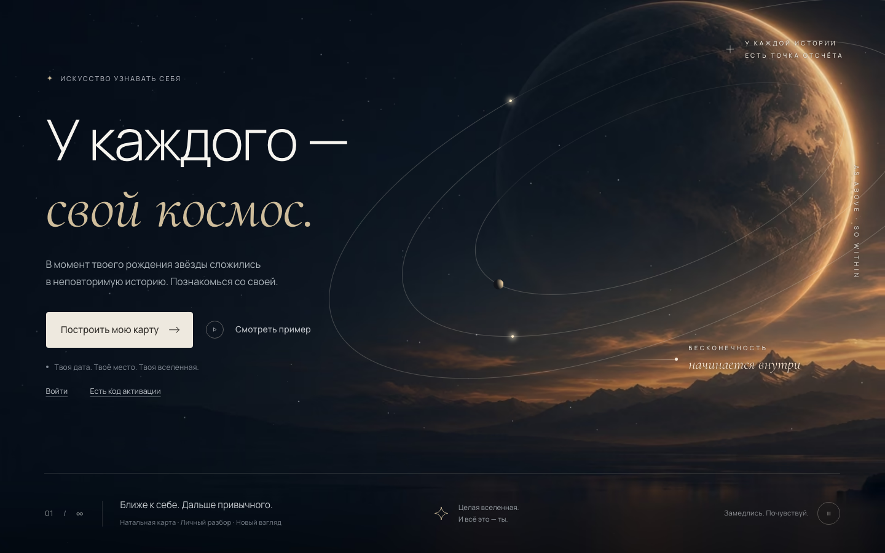
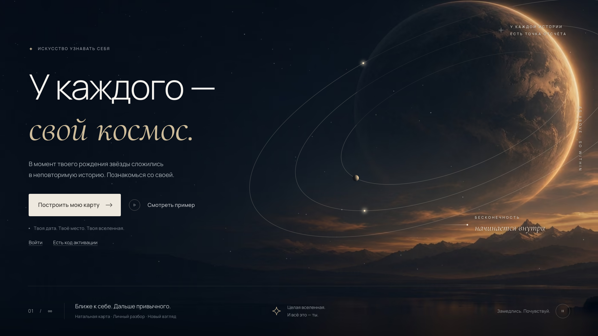
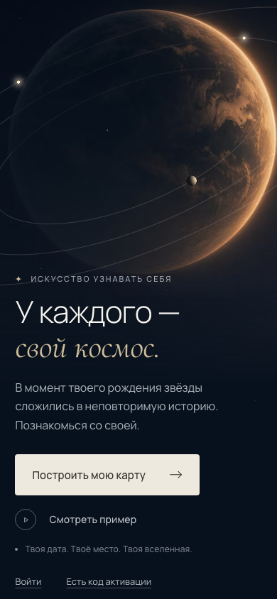
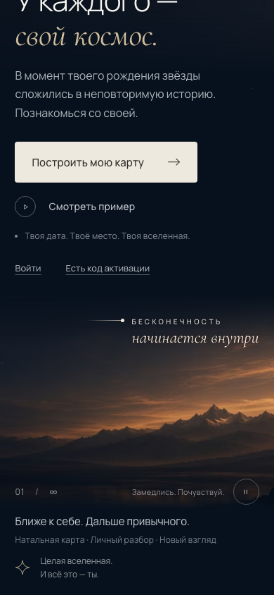
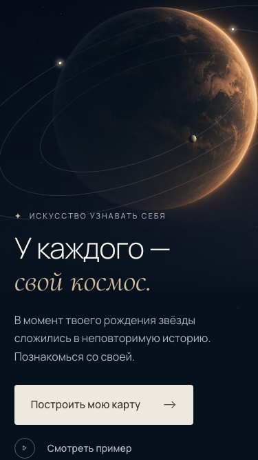

# V1.1 — отчёт о реализации первого экрана

Дата: 2026-11-11. Ветка: `feat/v1-hero` от `main` (261d004). Изменения не закоммичены. Журнал экрана: [`docs/frontend/screens/SCR-01.md`](../frontend/screens/SCR-01.md).

**Итог.** Главная собрана по `hero-approved.png` внутри существующей архитектуры `CosmosCanvas` + `SceneDirector`:
- огромная планета справа на временной пластине;
- атмосферный горизонт и тёмно-синее небо;
- процедурные звёзды, орбиты и тела в WebGL;
- текст и кнопки в HTML/CSS.

В кадре эталона 1440×873 все 17 опорных точек совпадают в пределах допуска 2%, большинство — с точностью 0–5px. Работают `npm run build`, `npm run typecheck`, `make e2e` и `make visual`. Тексты эталона не менялись. Backend не затрагивался, к V1.2 не переходил. Независимое ревью выполнено двумя изолированными субагентами, но помечено DEGRADED: движок impeccable не установлен, а его загрузку вы не согласовывали.

**После решений владельца** (PROJECT_DECISIONS п. 19–20):
- «Войти» и «Есть код активации» стоят строкой под заметкой на всех раскладках.
- Мобильная версия переделана по варианту B — собственная вертикальная композиция (SCR-01, стадия 7). Она ждёт вашей визуальной проверки.

## Скриншоты

Сцена заморожена (`?scene=freeze`), WebGL включён.

**Desktop 1440×900**

**Desktop 1920×1080**

**Mobile 390×844**: первый экран и конец прокрутки.

 

**Mobile 375×667** (низкий экран)

Дополнительно:
- `v1_1/home-tablet-768x1024.png` — планшет;
- `v1_1/reference-vs-home-1440x873.png` — эталон и реализация рядом в кадре эталона.

## 1. Что сделано по пунктам задачи

| # | Пункт | Что сделано |
|---|---|---|
| 1 | Временные ассеты (вариант B, Q16) | Две ИИ-пластины без текста, орбит и тел: `assets-src/hero/hero-{landscape,portrait}.temp-not-for-production.jpg`. Рядом LICENSE-файлы с промптом, SHA-256 и ограничениями. Эталон в ассет не копировался. Экспорт в AVIF и WebP делает `frontend/scripts/build-scene-plates.mjs`: результат 16–23 KB на пластину в `src/scene/plates/` |
| 2 | Композиция | Планета, горизонт и небо — на пластине (DOM-постер). Звёзды с мерцанием, три орбиты (дальняя половина приглушена на диске планеты), два светящихся тела и освещённая луна — в WebGL. Без WebGL то же рисуется в SVG |
| 3 | Типографика и кнопки | Manrope Variable и Cormorant Garamond Italic подключены локально (@fontsource, OFL). Основная кнопка «Построить мою карту →» ведёт на `/create`, второстепенная «Смотреть пример» — на `/example`. Подписи у планеты и нижняя полоса — HTML |
| 4 | Размеры и положения | Единица `u = min(W/1440, H/873)`. Планета задана в `u` от правого края, подписи — в долях радиуса планеты, полоса привязана к низу. Опорные точки проверяет `make visual` |
| 5 | Адаптив | Раскладка эталона от 960px по ширине, 600px по высоте и соотношения 6/5. В портрете (телефон, планшет) — собственная композиция варианта B (SCR-01, стадия 7). Короткие горизонтальные окна — столбик с затемнением. Горизонтальной прокрутки нет на 320–2560 |
| 6 | Подготовка к анимации | Композиции стали данными (`compositions.ts`): пластина, якорь планеты, система орбит, тела, интенсивность. V1.2 (M02) будет интерполировать между двумя наборами чисел. Геометрия общая для WebGL и SVG (`geometry.ts`). Части экрана размечены `data-hero-part` и `data-hero-ambient` |
| 7 | Архитектура сцены | Один постоянный canvas и один RAF-цикл сохранены, API `SceneDirector` только расширен: `setLayout`, `setMotion`, `setPointer`. Уровни качества, `?scene=freeze`, fallback при потере контекста работают как раньше. Добавлен dev-флаг `?tier=static` |
| 8 | Базовые переходы | M01 на CSS: заголовок собирается первым, затем текст и кнопки (900 мс, `--cosmos-ease-out`, шаг 80 мс). Подписи и полоса проявляются. Нажатие и hover у кнопок. Медленный дрейф тел и мерцание звёзд; параллакс за мышью на desktop, параллакс прокрутки на телефоне. Reduced motion: fade 200 мс, сцена на паузе, параллакса нет |

## 2. Проверки

| Команда | Результат |
|---|---|
| `npm run typecheck` | Без ошибок |
| `npm run lint` | Без ошибок |
| `npx vitest run` | 58 тестов, в том числе новые на раскладку, геометрию эталона, постер, паузу, reduced motion и портретную «землю» |
| `npm run build` + `check:bundle` | Сборка за ≈0.3 с, моков в `dist/` нет. HomeView ≈3.1 KB gzip JS; чанк Three.js ≈133 KB gzip загружается лениво (как в S0) |
| `make e2e` | 32 smoke-теста. Проверяют: • тексты эталона; • CTA без запросов к API заказов; • переходы на `/example`, `/login`, `/activate`; • паузу мышью, Enter и при reduced motion; • параллакс на телефоне включается и выключается; • портретную композицию на 390×844, 375×812, 375×667, 390×664 (CTA в первом экране, горизонт, подпись, «01 / ∞», пауза); • отсутствие горизонтальной прокрутки на 320–1440; • постер `?tier=static`; • порядок Tab; • axe без serious и critical на 1280 и 390 |
| `make visual` | 7 снимков, в том числе конец прокрутки 390×844 и низкий 375×667; 17 из 17 опорных точек в допуске; расхождение пикселей 7.1% (кадр эталона), 7.2% (1440×900), 12.8% (1920) |
| Визуальное сравнение | В кадре эталона совпадают базовые линии заголовка, акцентной строки и текста (Δ ≤ 0.1px), кнопка (Δ ≤ 2.2px), планета (Δ 0), линия полосы (Δ 0), кольцо паузы (Δ ≤ 1.5px). Орбиты и тела совпадают на наложении |
| Живая сцена | 60 FPS на уровне high; кадры через 1.5 с различаются, на паузе совпадают. Телефон (390×844, CPU ×4): прокрутка 60 fps, CLS 0 |
| Ревью, первый проход | Два изолированных субагента: дизайн-ревью (23/32 по Nielsen) и браузерные доказательства |
| Ревью мобильной версии B | Дизайн-ревью: 27/36 (75%), P0/P1 нет. Браузерные доказательства: axe 0 нарушений на 390×844, 375×667, 1440×873; контраст по пикселям проходит у всех подписей. Оба прохода DEGRADED: детектор `impeccable detect` не запускался |

Как проверялось:
- `make e2e` и `make visual` запускались против уже работающего Vite на 5173 (`reuseExistingServer`).
- Контраст измерялся по отрисованным пикселям: axe не видит фон под canvas и помечает эти проверки как незавершённые.

## 3. Решения

1. **Пластина в DOM, движущиеся слои в WebGL.** Canvas прозрачный (`alpha:true`), под ним постер `<picture>` с AVIF и WebP. Первая отрисовка, уровень static и fallback дают одну и ту же картинку, а WebGL добавляет только движение. Этот приём подтверждают и рекомендации ui-ux-pro-max для three.js.
2. **Орбиты — ленты, а не GL-линии.** GL-линия всегда шириной в один пиксель устройства и на retina становится тоньше эталона. Лента держит 1.1u на любом DPR и сглаживается в шейдере.
3. **Геометрия измерена, а не нарисована на глаз.** Планета найдена по хордам профиля яркости, орбиты — общий эллипс (наклон −22.5°, сжатие 0.41) с центром относительно планеты, тела стоят в положениях эталона (проверяется тестом). Все длины выражены в радиусах планеты, поэтому система держится на любом экране.
4. **Покрытие экрана важнее размера планеты.** Если пластина не закрывает экран, она масштабируется дальше, а орбиты и подписи следуют за фактической планетой.
5. **«Замедлись. Почувствуй.» с кольцом «II» — настоящая кнопка паузы фонового движения** (WCAG 2.2.2). При reduced motion сцена стартует на паузе, выбор сохраняется в `sessionStorage`.
6. **Шрифты.** Manrope шире шрифта эталона, поэтому заголовок 92px подобран по длине строки (совпадение до 5px), а не по высоте прописных.
7. **Dev-панель перенесена в правый верхний угол.** Внизу справа она перекрывала кнопку паузы.
8. **Горизонт на телефоне рисует страница, а не сцена.** Композиция объявляет `ground: 'page'`: сцена растворяет пластину ниже неба, а `SceneGround.vue` кладёт нижнюю полосу той же пластины в поток страницы. Тот же файл, масштаб и сдвиг — второй загрузки нет. Подпись и полоса стоят точно на линии воды и прокручиваются вместе с ней.
9. **Параллакс на телефоне — CSS scroll-driven, без JS и гироскопа.** Слой сцены в портрете прокручивается вместе со страницей, при включённом движении отстаёт до 0.75 скорости, горы поднимаются на 28px при входе. Анимации идут на compositor, весь слой движется целиком, поэтому WebGL-орбиты не отрываются от нарисованной планеты. Без поддержки, при паузе и reduced motion небо просто прокручивается со страницей.
10. **Увеличенная планета сохраняет края.** Если пластину пришлось увеличить, чтобы закрыть экран (планшет), верхний и освещённый края диска остаются там, где их задумали.

## 4. Отличия от эталона

| Отличие | Причина |
|---|---|
| Мелкий текст крупнее: основной текст 16px (≈13.75 в эталоне), кнопка 15, второстепенная кнопка 14, заметка 12, полоса не меньше 11, подписи у планеты не меньше 10, «начинается внутри» 24 | DESIGN_SYSTEM: основной текст 16–18px; контраст и читаемость |
| Заголовок 92px вместо ≈96.5px; на 1920 ограничен 112px | Ширина Manrope; ограничение DESIGN_SYSTEM |
| Акцентная строка `#cfbd9b` вместо `--cosmos-gold` `#c8aa77` | Эталон светлее токена; новый токен `--cosmos-gold-pale`, ждёт согласования |
| Подписи у планеты ярче, с тёмным ореолом | В эталоне они 6–8px и почти не читаются; по пикселям контраст был 3.3–4.2:1 |
| Пластина: тёмная сторона планеты площе, кромка уже, облака другие; сетка на небе заходит на диск | Временная ИИ-генерация, а не копия эталона |
| Луна и ореолы тел нарисованы, а не взяты из эталона | Тела — слои сцены, будут двигаться в V1.2 |
| Мобильная и планшетная раскладка | Эталона нет; вариант B по решению владельца (п. 20, SCR-01, стадия 7) |
| Строка «Войти · Есть код активации» под заметкой | Решение владельца по C20 (п. 19) |
| Вертикальная подпись «AS ABOVE · SO WITHIN» | Чтение по эталону неуверенное |

## 5. Нерешённые проблемы и вопросы владельцу

**Закрыто решениями владельца**: пути к кабинету и активации (п. 19), мобильная композиция (п. 20, вариант B).

**Нужно ваше решение**
1. Визуальная проверка мобильной версии B (390, 375, низкие экраны, конец прокрутки): без неё она не считается утверждённой.
2. Утвердить калибровку токенов `--cosmos-gold-pale` и `--cosmos-ink`, увеличение мелкого текста и чтение вертикальной подписи.
3. Оба ревью заметили: на первом экране нигде не сказано, что продаётся («натальная карта» есть только в мелкой подписи полосы, на телефоне — в самом конце страницы). Тексты не трогал.
4. На первом экране 390×844 нет тёплого края горизонта (ревью A, P2). Не принято: текст и CTA занимают экран до 841px, а дымка под заметкой или подписью ломает контраст. Видна на экранах выше ≈900px.

**Технические хвосты** (не блокируют V1.1)
- Края подписей над самой светлой частью кромки ниже 4.5:1 по 10% самых светлых пикселей. По медиане три подписи из четырёх проходят. Подписи помечены `aria-hidden` как декоративные; нужно либо признать их декорацией, либо делать финальную пластину с более тёмной кромкой под ними.
- `routeFade` при reduced motion длится 400 мс: TS-токен не следует за CSS-переопределением. Это наследие S0; движение только по opacity.
- Пластины ниже бюджета §17.2c: 1464 px landscape, 720 px portrait; на планшете с 2× портретная пластина мягкая. Финальные ассеты — до среза 11.
- Hover основной кнопки почти незаметен, работает в основном сдвиг стрелки.
- Чанк Three.js ≈133 KB gzip: tree-shaking импортов не делался.
- `build-scene-plates.mjs` использует системные `sips` (macOS), `cwebp` и `avifenc`. Сборке приложения они не нужны: результат лежит в репозитории.
- Снимок critique в `.impeccable/critique/` не сохранён: для этого нужен движок impeccable (по п. 18 ставится в `IMPECCABLE_HOME` проекта после просмотра алерта Socket — нужно ваше согласование на загрузку).
- Тела дрейфуют по орбитам. Через несколько минут тело может пройти под текстом, пока небо отстаёт при прокрутке; текст лежит поверх и остаётся читаемым.
- Параллакс прокрутки в Firefox без scroll timelines не работает: небо просто прокручивается со страницей.
- Из эталона: кольцо play у «Смотреть пример» похоже на видео, «01 / ∞» — на счётчик слайдов.

## 6. Изменённые файлы

Новые:
- `assets-src/hero/`: два мастера, два LICENSE-файла, `plates.config.json`;
- `frontend/scripts/build-scene-plates.mjs`;
- `frontend/src/features/home/{HomeView,MotionToggle}.vue`;
- `frontend/src/ui/{CosmosIcon,PrimaryCTA,SecondaryCTA}.vue`;
- `frontend/src/scene/{geometry,layers,layout,plates}.ts`, `ScenePoster.vue`, `SceneGround.vue`, `plates/*`, `{geometry,layout}.spec.ts`;
- `e2e/smoke/home.spec.ts`, `e2e/visual/reference/hero-anchors.json`;
- `docs/frontend/screens/SCR-01.md`, `docs/reports/V1_1_IMPLEMENTATION_REPORT.md`, `docs/reports/v1_1/*.png`.

Изменённые:
- `frontend/src/scene/{SceneDirector.ts,CosmosCanvas.vue,CosmosCanvas.spec.ts,compositions.ts,sceneStore.ts,deterministic.ts,quality.ts}`;
- `frontend/src/{main.ts,app/routes.ts,app/DevPanel.vue,ui/tokens.css,ui/base.css}`;
- `e2e/smoke/app.spec.ts`, `e2e/visual/{compare.mjs,snapshot.spec.ts,viewports.ts}`;
- `docs/PROJECT_DECISIONS.md` (решения п. 19–20);
- `package.json` и `package-lock.json` в `frontend/` и `e2e/`.

Новые зависимости — только npm-пакеты, без исполняемых компонентов: `@fontsource-variable/manrope`, `@fontsource/cormorant-garamond`; dev — `pngjs`, `@types/pngjs`, `@axe-core/playwright`.

`.idea/*` в рабочем дереве созданы IDE, к срезу не относятся.
