# V1.2 — отчёт о реализации: переход с главной и анкета рождения

Статус: **Утверждено владельцем** (11.11.2026).

Дата: 2026-11-11. Ветка: `feat/v1-hero`, коммит 4bd652a поверх 17fac5c (V1.1). Журнал экрана: [`docs/frontend/screens/SCR-02.md`](../frontend/screens/SCR-02.md), включая «Журнал реализации» Ж1–Ж13.

**Финальная полировка перед приёмкой (решения владельца по Ж9, Ж11, Ж12) — §8.** Коротко:
- **Ж11:** при возврате на главную M01 больше не повторяется, вместо него — один спокойный вход слоем. Первое открытие не изменилось: 0 px на 7 размерах.
- **Ж12:** горизонт на desktop-кадрах даты и времени уходит в фон длинной плавной растушёвкой, без полосы. Пластина, планета и орбиты на месте, mobile-кадры не изменились до байта.
- **Ж9:** компоновка оставлена. Клавиатурная проверка нашла и закрыла три дефекта:
  - подсказки города рисовались под кнопками;
  - поле прижималось к краю клавиатуры;
  - сквозь список проступала кнопка.
- **Быстрые переходы:** canvas один, WebGL-контекст не пересоздаётся, камера без рывков, данные целы — покрыто E2E.
- **Проверки:**
  - `make ci` зелёный; `check-gen` прошёл после коммита 4bd652a (см. §8.5);
  - `make visual` — 35 / 35.

**Итог среза.**
- **Что сделано:**
  - перелёт камеры с главной в анкету;
  - четыре шага SCR-02: имя, дата, место, время;
  - перелёты между шагами.

  Всё работает в одном `CosmosCanvas` с одним `SceneDirector`: фон не переключается.
- **Главная не изменилась:** снимки на 7 размерах экрана совпадают с утверждёнными до пикселя, ни одна из опорных точек не сдвинулась.
- **Проверки:** проходят все — unit 208, Playwright 86 (57 smoke и 29 визуальных), линтер, проверка типов, сборка, `check:bundle`.
- **Чего нет в срезе:** платных вызовов, кодов активации, backend и данных клиентов. Город ищется по типизированному мок-API с синтетическим справочником.
- **Ревью:** выполнено двумя изолированными субагентами, режим DEGRADED (движок impeccable не установлен). Найденные ошибки исправлены.
- **Утверждено владельцем:** кадры и перелёты по снимкам; решения по Ж9, Ж11 и Ж12 приняты и выполнены (§6, §8).
- Дальше этого среза работа не шла.

## 1. Снимки

Сцена заморожена (`?scene=freeze`), WebGL включён, данные синтетические. Снимки ниже пересняты после финальной полировки: на desktop-кадрах даты и времени уже новая растушёвка горизонта. Сравнение «до/после» и новые состояния — §8.

**Desktop 1440×900: шаги 01–04**

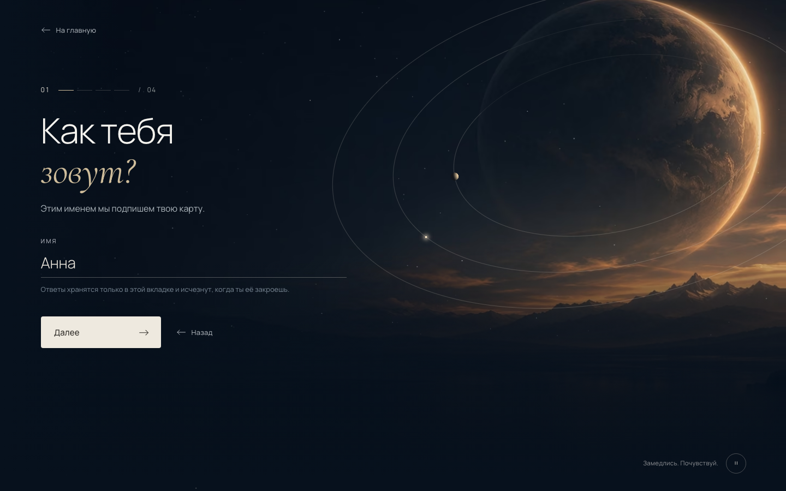
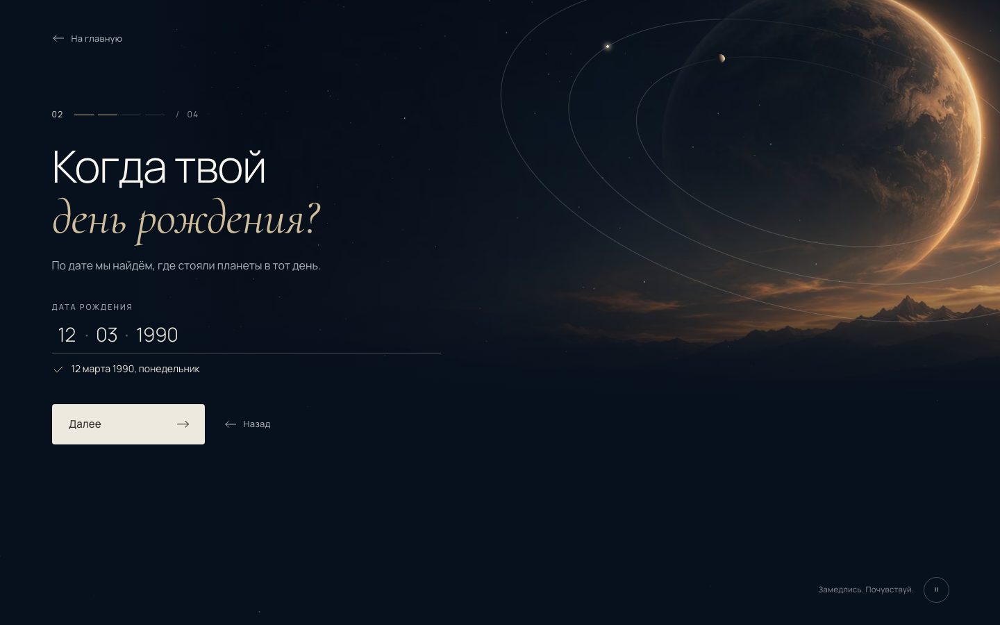
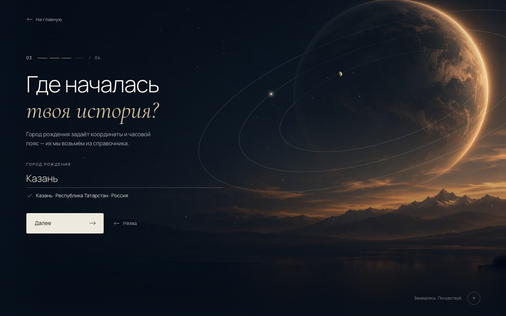
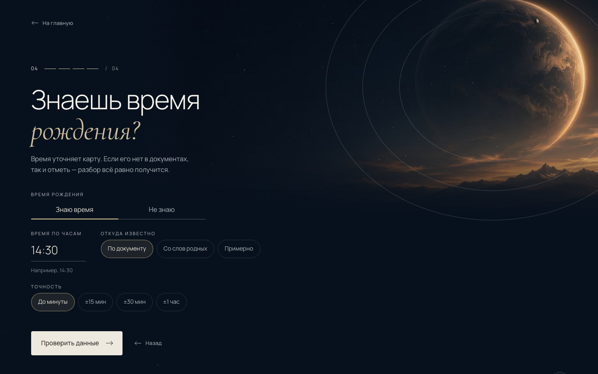

**Mobile 390×844: шаги 01–04**

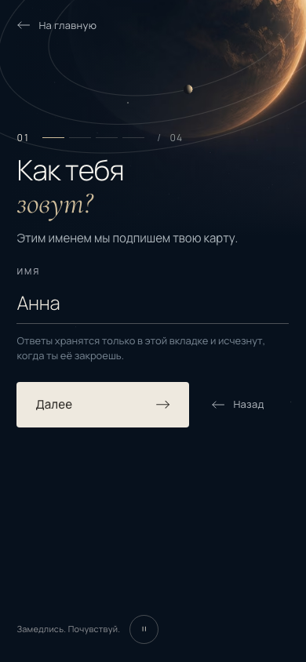  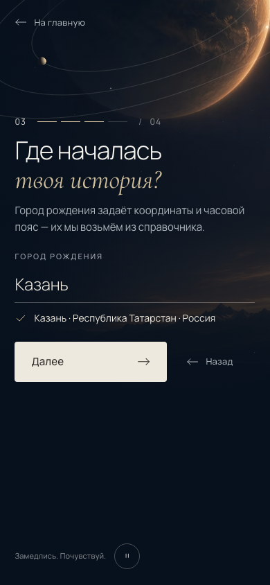 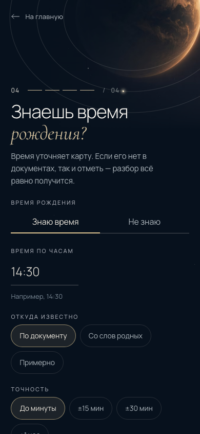

**Планшет 768×1024 и низкий телефон 375×667: шаг 04, самый длинный**

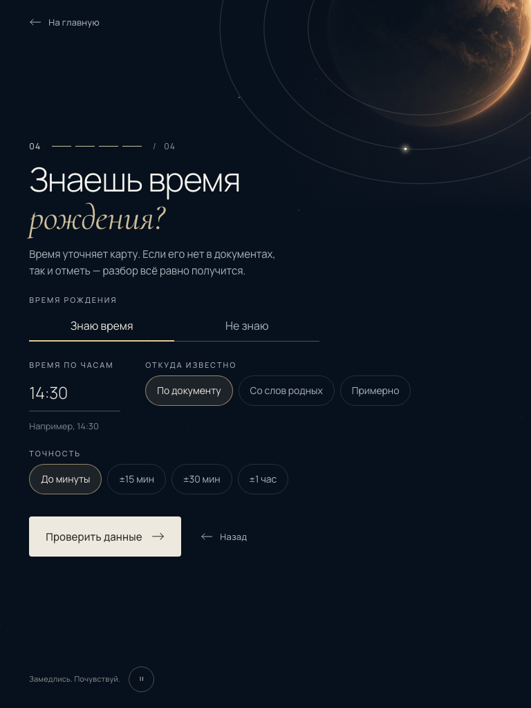 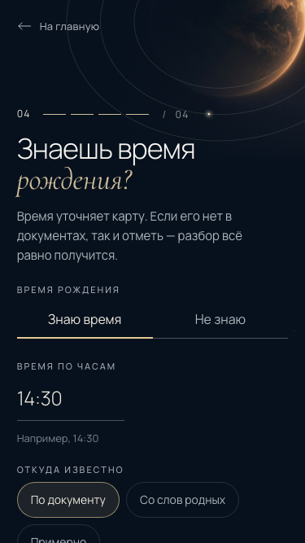

**Перелёт главная → шаг 01:** 0%, 35%, 70% и 100% времени. Текст скрыт, чтобы был виден кадр.

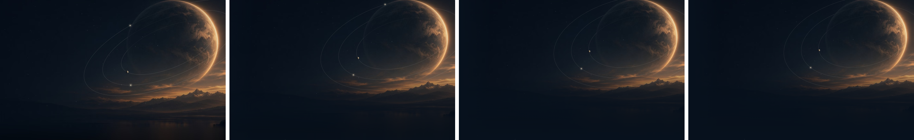
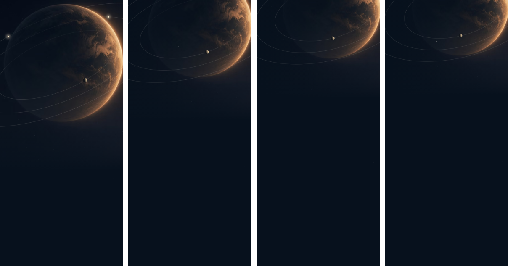

Полный набор кадров (4 шага × 5 размеров экрана) собирает `make visual` в `e2e/visual/output/intake/`; ленту перелёта — `node visual/strip.mjs`.

## 2. Требования задачи

| # | Требование | Как выполнено |
|---|---|---|
| 1 | Не менять утверждённую главную | В `HomeView.vue` изменён только вариант ухода (`heroExit`) и источник кадра горизонта. Регрессия `regress.mjs` против снимков V1.1: 0 px на 1440, 1920, 768, 390, 390-конец, 375×667 и эталонном 1440×873, опорные точки на месте (Ж4) |
| 2 | Один CosmosCanvas и SceneDirector | Канвас один на всё приложение (проверяет smoke). Кадр — данные `compositions.ts` (`intake.name\|date\|place\|time`, landscape и portrait). Director интерполирует снимок сцены, из которого одновременно строятся пластина и слои WebGL |
| 3 | Пространственный переход без резкой смены фона | Камера наклоняется и отъезжает, 1400 мс, `cinematic`. Звёзды смещаются на 0.3 от хода планеты, орбиты раскрываются, тела идут по орбитам. Если главная была прокручена (портрет), перелёт стартует с видимого положения неба |
| 4 | Четыре шага | `/create?step=name\|date\|place\|time` (решение 22) |
| 5 | Свой кадр у каждого шага, одна семья | Ж1: разные наклон, сжатие орбит, отъезд и горизонт; общие планета, палитра, колонка и типографика |
| 6 | Motion for Vue для UI, Three.js для фона | Блоки шагов меняются через `AnimatePresence popLayout` с направлением; маршруты — `AnimatePresence mode="wait"`; фон — `SceneDirector` |
| 7 | Данные сохраняются между шагами | Pinia `useIntakeDraft`. E2E: «Назад», кнопки браузера «Назад» и «Вперёд», перезагрузка |
| 8 | Черновик гостя в sessionStorage | Ключ `cosmos.intake.v1`, версия 1, TTL 24 ч, запись не чаще раза в 150 мс и на `pagehide`. Повреждённая запись удаляется. В URL только шаг (проверяет E2E-01) |
| 9 | Типизированный mock API городов | `api/openapi.yaml`: `GET /api/v1/places?q`, `GET /api/v1/places/{id}`. Типы из `schema.d.ts`, клиент `openapi-fetch`, MSW-обработчики с режимами `?places=slow\|empty\|error`, 45 синтетических городов |
| 10 | Назад, ошибки ввода, mobile, reduced motion | Тексты ошибок по §0.5 (иконка + текст, `aria-invalid`, фокус в поле). Портретные кадры. Reduced motion: без перелёта, кроссфейд кадра, только opacity в DOM |
| 11 | Без платной генерации, кодов и backend | Запросов к заказам нет (MOT-01 в E2E-01). Backend не менялся |
| 12 | Плавно и без блокировки ввода | 60 fps на desktop и на телефоне с CPU ×4. Ввод во время перелёта работает (MOT-03). Ничего не ждёт окончания анимации |

## 3. Что сделано

**Сцена (`frontend/src/scene/`)**
- `interpolate.ts`, `tween.ts`. Снимок сцены, его смешивание и перелёт с ретаргетингом. При прерывании сохраняются и позиция, и скорость (Ж3).
- `SceneDirector.ts`:
  - `setLayout(layout, transition)` и dev-перемотка `preview`;
  - пластина ставится императивно в том же кадре, что и WebGL;
  - цикл работает, пока идёт перелёт, даже при паузе фона;
  - в скрытой вкладке сразу ставится конечный кадр.
- `CosmosCanvas.vue`:
  - выбор композиции по маршруту и шагу;
  - если окно меняет размер посреди перелёта, полёт продолжается к новой цели;
  - при потере WebGL сцена доигрывает перелёт на пластине;
  - при reduced motion — кроссфейд кадра.
- `ScenePoster.vue`, `placement.ts`. Пластина размечена в масштабе главной, растушёваны левый и нижний края, есть копия для кроссфейда. На уровне `static` перелёт делает сама пластина.
- `compositions.ts`. Восемь кадров анкеты. `compositions.spec` проверяет ограничения камеры на восьми размерах экрана.

**Анкета (`frontend/src/features/intake/`)**
- `IntakeView.vue`:
  - шаги, их направление и смена блоков;
  - фокус: на сенсорных экранах — заголовок, на desktop — поле (решение 25);
  - защита Enter от IME;
  - связка «Назад» с историей браузера.
- `NameStep`, `DateStep`, `PlaceStep`, `TimeStep`, `ChoiceGroup`, `IntakeQuestion`; `ui/Field.vue`, `ui/ProgressStep.vue`.
- `CityCombobox.vue`:
  - combobox ARIA 1.2 с автоматически активной первой строкой;
  - задержка поиска 250 мс; «Ищем…» после 300 мс;
  - отмена старых запросов через `AbortController`, ответы не по порядку отбрасываются;
  - состояния «пусто» и «ошибка» с кнопкой «Повторить».
- `validation.ts`:
  - имя — от 1 до 60 кодовых точек;
  - дата — реальная, от 1900 года до сегодняшнего дня по Москве, с расшифровкой словами;
  - время, а точность подставляется по источнику.
- `draft.ts`, `guard.ts`, `steps.ts`. Ссылка не открывает шаг дальше первого незаполненного (`router.replace`).

**Прочее**
- `index.html`: `interactive-widget=resizes-visual`.
- Модуль анкеты загружается заранее, пока посетитель на главной.
- `e2e/visual/intake.spec.ts`, `regress.mjs`, `strip.mjs`: снимки, регрессия главной, лента перелёта.

## 4. Проверки

| Проверка | Результат |
|---|---|
| `npm run lint`, `npm run typecheck` | 0 ошибок |
| `npm test` (Vitest) | 208 / 208. Новое: валидация, черновик, guard и `sceneOf`, интерполяция и ретаргетинг (непрерывность скорости), ограничения кадров, combobox (задержка, отмена устаревших ответов, стрелки, Enter не отправляет форму, Escape, ARIA, «Ищем…», пусто, ошибка и повтор), перелёт на уровне `static` и при смене размера окна |
| `npm run build`, `check:bundle` | Сборка проходит, кода моков в `dist/` нет |
| Playwright smoke | 57 / 57. E2E-01: вся анкета с клавиатуры, без запросов к заказам и без данных в URL. E2E-02: «Не знаю». Ошибки на каждом шаге. MOT-02: «Назад» и кнопки браузера. Перезагрузка и недоступный шаг. Повреждённый черновик. Три состояния поиска. MOT-03, MOT-10, MOT-11. 390×844 и 375×667: нет горизонтальной прокрутки, заголовок в фокусе, поле выше клавиатуры. axe на четырёх шагах. Консоль без ошибок. Все тесты главной |
| Playwright visual + `regress.mjs` | 29 / 29, главная — 0 px на 7 размерах |
| Живой Chromium, desktop high | Перелёт с главной: 1400 мс, 60 fps, p95 кадра 17.6 мс, кадров > 50 мс нет (до предзагрузки модуля их было 2–3). Между шагами — 56 fps. «Далее → Назад → Далее» заканчивается одним блоком. Скорость камеры при повторном клике непрерывна (−0.337 → −0.309 px/мс) |
| Живой Chromium, 390×844, medium, CPU ×4 | Перелёт с главной и смена шага: 60 fps, кадров > 50 мс нет, следующий кадр через 24 мс после клика |

Не проверено: настоящие iOS и Android с экранной клавиатурой и слабым GPU. Замедление CPU не нагружает видеокарту, поэтому замер на medium — оценка сверху.

Один раз на узком окне (573×566) после серии быстрых переходов страница оказалась прокручена на 141 px. Воспроизвести не удалось ни одним сценарием по отдельности: вход с главной, ввод во время перелёта, автопереход полей даты, прерывания. Стоит перепроверить на устройствах.

## 5. Ревью (DEGRADED: движок impeccable не установлен, два изолированных субагента)

**Визуальная критика** (frontend-design, impeccable critique). Исправлено:
- на телефонах ужат вертикальный ритм, форма поднялась примерно на 45 px;
- расшифровка даты оформлена как подтверждение, как выбранный город;
- фокус в полях показывает золотое подчёркивание, без двойной рамки;
- подсказки внутри полей стали контрастнее (0.38 → 0.6);
- у поля времени есть подсказка «Например, 14:30»;
- заметка о хранении ответов перенесена под поле шага 01 (§0.6);
- в найденном при проверке баге свёрнутый блок времени оставлял пустой отступ 36 px.

Не исправлено и передано владельцу: Ж9 (поле в верхней половине экрана), Ж12 (горизонт на кадрах даты и времени). Остальное не исправлено, потому что меняет согласованную спецификацию или кадры:
- точность времени, свёрнутая в строку «Изменить»;
- горизонт у нижнего края на телефонах;
- скрытие «Назад» на шаге 01.

**Motion-ревью** (emil-design-eng):

| Элемент | Before | After | Why |
|---|---|---|---|
| Ретаргетинг камеры | Новый перелёт из текущей точки, скорость обнуляется | Скорость сохраняется и гаснет по `p(1 − p)²` к концу перелёта | На «Далее → Далее» камера запиналась на пике |
| Перелёт при смене размера окна | Обрыв (cut) в конечный кадр | Доводка к новой цели за оставшееся время, скорость сохраняется | Скачок, когда с уходом главной исчезает полоса прокрутки |
| Пластина в полёте | Без отдельного слоя | `will-change: transform` только во время перелёта | Нет перерисовки 1280×720 на каждом кадре, растр в покое прежний |
| Монтирование анкеты | Чанк грузился при клике, 2–3 кадра > 50 мс | Модуль загружается заранее в простое | Длинный кадр совпадал с пиком скорости |
| «Знаю / Не знаю» | Поля сворачивались, пояснение пропадало мгновенно | Встречное сворачивание за 320 мс; opacity 200 мс после раскрытия, 120 мс до сворачивания | Кнопки прыгали дважды на высоту абзаца |
| Метка сегмента | Без выбора влетала из-за края (−100%) | Ждёт под первым вариантом | Движение без смысла |
| Подчёркивание поля | 600 мс `inOut` с 120 мс, под ещё прозрачной строкой | 480 мс `out` с 260 мс | Рисовалось невидимым, стартовало вяло |
| Кроссфейд при reduced motion | Пластина 240 мс `linear`, canvas 200 мс `ease-out` | Обе по `--cosmos-dur-route`, `ease-out` | Пластина и орбиты меняются синхронно |
| Уход анкеты на главную | opacity и blur, камера 1400 мс | + сдвиг вправо 20 px, камера 1200 мс | Как в плане §2.2: обратный путь спокойнее и короче |

Исправленные ошибки из motion-ревью:
- **Ref-колбэки блоков шагов** читали текущий шаг в момент вызова. Уходящий блок мог стереть записи нового шага, от этого зависят фокус при ошибке и `inert`. Теперь колбэк создаётся на рендере вместе с ключом. Добавлен E2E-тест. До исправления Vue восстанавливал записи следующим перерендером, поэтому на практике ошибка не проявлялась.
- **Класс `is-cut` на canvas** ставился и снимался до пересчёта стилей, кроссфейд орбит при reduced motion не срабатывал. Теперь класс снимается через два кадра.
- **Копия пластины для кроссфейда** грузила другой файл (webp вместо выбранного avif). Теперь берёт `currentSrc`.
- **Скрытая вкладка при паузе фона:** конечный кадр не отрисовывался до следующего события. Добавлена отрисовка.
- **Потеря WebGL посреди перелёта** давала скачок в конец. Теперь пластина доигрывает оставшееся время.

Повтор M01 при возврате на главную (Ж11) убран в финальной полировке (§8.1). Фокус при входе с главной приходит на 300–450 мс (Ж6): так устроен `mode="wait"`, и это соответствует плану.

## 6. Решения владельца

1. ~~Кадры и перелёт~~ — **утверждены** по снимкам из §1 (SCR-02 §0.3, Ж1).
2. ~~Ж9~~ — **решено:** мобильную компоновку оставить, проверить клавиатуру (§8.3).
3. ~~Ж11~~ — **решено:** убрать повтор M01, вместо него спокойный обратный переход (§8.1).
4. ~~Ж12~~ — **решено:** смягчить растушёвкой, планету и орбиты не трогать (§8.2).

## 7. Отклонения от плана стадии 0

Подробно — SCR-02, «Журнал реализации».
- **Ж1.** Кадры подняты, потому что камера может только наклоняться и отъезжать.
- **Ж2.** Кривая камеры `(0.3, 0.05, 0.1, 1)`.
- **Ж3.** Ретаргетинг сохраняет скорость.
- **Ж6.** Фокус при входе с главной приходит на 300–450 мс.
- **Ж7.** Раскладка шага 04 изменена.
- **Ж8.** Фокус полей, подтверждение даты и место заметки.
- **Ж10.** Длительность кроссфейда 200 мс вместо 240 мс.
- **Удалён `scrollBehavior` роутера:** в vue-router 5 он устарел, а анкета сама прокручивает страницу к началу при монтировании, как и планировалось.

## 8. Финальная полировка перед приёмкой

Решения владельца: Ж9 — оставить мобильную компоновку и проверить клавиатуру; Ж11 — убрать повтор M01 при возврате; Ж12 — смягчить горизонт на desktop-кадрах даты и времени. Визуальные композиции четырёх шагов не менялись. Подробности и числа — в SCR-02, Ж9, Ж11, Ж12, Ж13.

### 8.1. Ж11: возврат на главную без повтора M01

- **Первое открытие** — M01 без изменений: 7 поэлементных анимаций `hero-part-in`, а главная совпадает с эталоном до пикселя на 7 размерах.
- **Возврат** (класс `home--return`):
  - `main` появляется одним слоем за 500 мс `out`: opacity и сдвиг −12 px → 0, зеркально уходу анкеты вправо;
  - подписи у планеты и нижняя полоса проявляются, когда камера почти дома (после 1000 мс), чтобы не висеть рядом с летящей планетой;
  - если фокус раньше попадает на кнопку паузы, задержка снимается.
- **Reduced motion:** сдвига нет, остаётся только проявление.
- **E2E:** проверяет 7 анимаций при первом открытии и 0 — при возврате.

Лента, живые кадры примерно через 0, 250, 600 и 1600 мс после «На главную» (чип «S0 · данные: MSW-моки» — dev-панель):

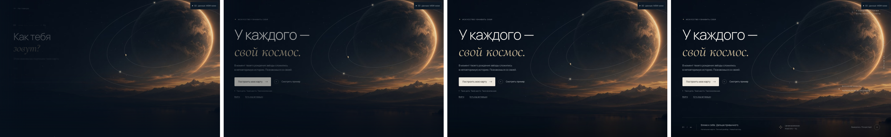
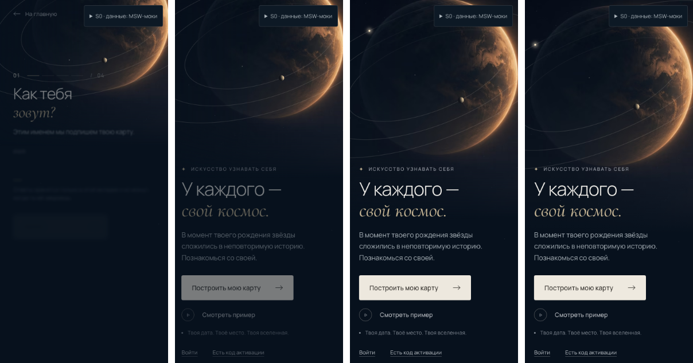

### 8.2. Ж12: горизонт на desktop-кадрах даты и времени

- **Было:** вуаль земли линейно доходила до цвета неба и обрывалась на `groundTop`. Под хребтами оставалась видимая полоса.
- **Стало:** вуаль начинается там же, но тянется ещё 90 строк пластины по кривой smoothstep.
- **Только landscape-пластина:** у portrait `groundFeather: 0`, mobile-кадры не изменились до байта.
- **Положение планеты и орбит:** не изменилось, пиксели меняются только ниже прежней верхней границы вуали.
- **Кадр места и главная:** до пикселя прежние.

| | Дата | Время |
|---|---|---|
| До | 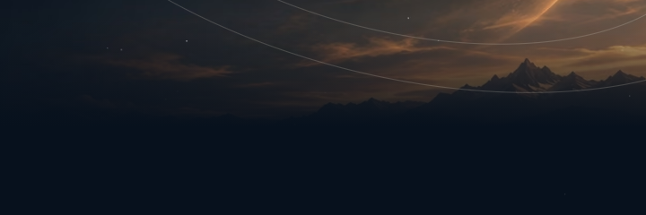 | 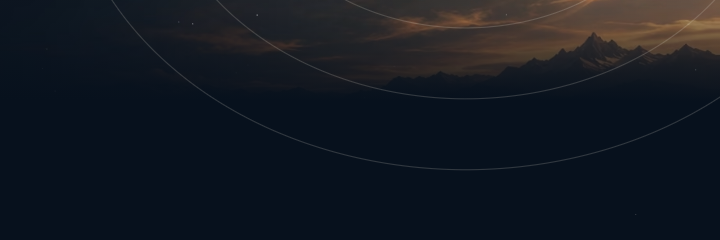 |
| После | 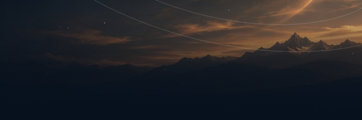 | 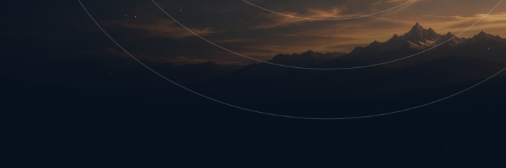 |

Полные кадры: [дата до](v1_2/polish/desktop-1440-date-before.png), [время до](v1_2/polish/desktop-1440-time-before.png); «после» — в §1.

### 8.3. Ж9 и шаг 04: экранная клавиатура на 375×667 и 390×844

**Модель:** viewport сжимается на 336 px (клавиатура iOS с панелью подсказок), сфокусированное поле прокручивается в видимую область. Это строже реального поведения: страница объявляет `interactive-widget=resizes-visual`, поэтому на устройстве клавиатура только перекрывает низ, а сцена и canvas не меняют размер.

**Проверено E2E** для «Имя», «День», «Год», «Город рождения» и «Время по часам» на обоих размерах:
- поле и его подсказка целиком над клавиатурой;
- поле не перекрыто;
- две первые подсказки города видны и не перекрыты;
- горизонтальной прокрутки нет, canvas один.

**Найдено и исправлено:**
- **Подсказки города под кнопками.** Список подсказок рисовался **под** кнопками «Далее»/«Назад»: каждая строка шага — свой контекст наложения. Порядок слоёв теперь задан явно: уходящий шаг < кнопки < живой шаг. Заодно исправлено старое перекрытие: высокий уходящий шаг около 200 мс лежал поверх кнопок при «Назад» с шага 04. Добавлен тест, проверен мутацией.
- **Подсказка под клавиатурой.** Поле прижималось к краю клавиатуры, и подсказка уходила под неё. Добавлен `scroll-margin` для полей; у поля города запас под две подсказки.
- **Просвечивающий фон списка.** Он был непрозрачен на 97%, и сквозь него проступала кремовая кнопка. Теперь фон непрозрачный.

Видимая над клавиатурой часть страницы:

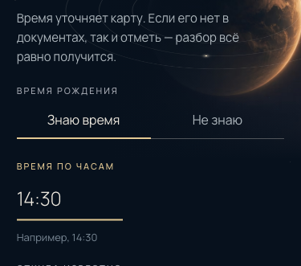 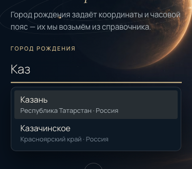 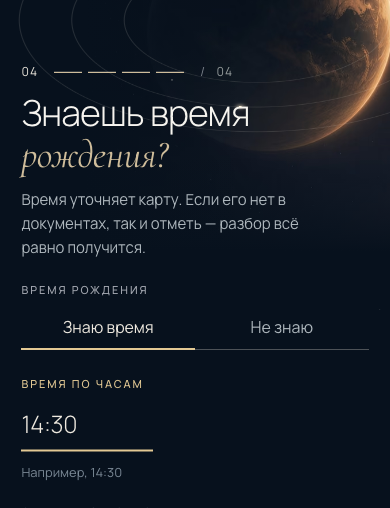 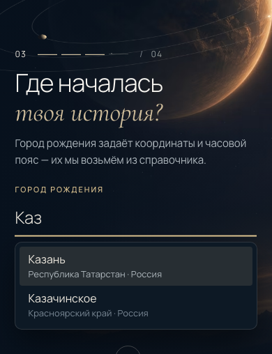

**Не проверено на устройстве:** настоящая клавиатура iOS/Android. В частности, на iOS `42vh` у списка не уменьшается с клавиатурой; низ списка может уйти под неё, но список прокручивается сам.

### 8.4. Быстрые переходы вперёд-назад

**Сценарий E2E:** «Далее», «Далее», «Назад», браузер «назад» и «вперёд», «Далее», «Далее», браузер «назад», «Назад» — с паузой 140 мс, то есть внутри полёта камеры. В каждом кадре снимается положение пластины.

**Результат:**
- новых canvas и WebGL-контекстов нет;
- сцена приходит в кадр шага из URL;
- черновик целый;
- пиковая скорость камеры ≈ 0.46 px/мс при пороге 1.5.

Если подменить ретаргетинг рывком к старой цели, пик — 20.9 px/мс, и тест падает.

### 8.5. Ревью и проверки

**Motion-ревью** (emil-design-eng):

| Before | After | Why |
|---|---|---|
| Возврат на главную повторял M01: 7 элементов с blur, 900 мс, шаг 80 мс | Один слой: opacity и −12 px → 0, 500 мс `out` | Обратный путь повторяется часто; полная хореография на каждом возврате утомляет и задерживает текст |
| Подписи у планеты появлялись с остальным текстом | Ждут 1000 мс, пока камера (1200 мс) почти дома | Подписи привязаны к планете; в полёте они висели бы отдельно от неё |
| Задержка 80 мс перед входом главной | Без задержки | Пауза уже есть: `mode="wait"` ждёт ухода анкеты (200 мс) |
| Линейная вуаль горизонта | Smoothstep с хвостом на 90 строк | У линейного перехода на стыке со сплошным цветом видна полоса Маха |

**Доступное визуальное ревью** (impeccable critique и audit; DEGRADED: движок не установлен, два изолированных субагента без контекста автора).

Оценки: горизонт 8/10, клавиатура 7/10, возврат 7/10. P0 нет. Исправлено:
- **P1 у обоих ревьюеров:** вторая строка активной подсказки города — 3.75:1 на золотой подсветке. Теперь `--cosmos-muted`, ≈ 6.8:1.
- **Placeholder полей** ≈ 4.0:1 → `--cosmos-faint`, ≈ 5.1:1. В полях даты это единственная подпись части даты.
- **Невидимая кнопка паузы** при возврате могла получить фокус: задержка снимается по `:focus-within`.
- **Перекрытие кнопок уходящим шагом** — см. §8.3. Аудитор связал его с новым `z-index`; на деле оно было и раньше, и тест это показал.

Не исправлено:
- **Blur уходящей кнопки «Далее»** заметнее, чем у текста (P2). Это утверждённый уход шага `stepExit`.
- **Подписи главной при возврате появляются второй волной** (P2). Это сделано намеренно, см. таблицу выше.
Отдельно по совместимости. `color-mix()` в растушёвке требует Safari 16.2+ и Chrome 111+, а цель сборки Vite по умолчанию допускает более старые браузеры. Плавная вуаль подключается через `@supports`, остальные получают прежнюю линейную, поэтому вуаль не пропадает ни в одном браузере.

**Проверки:**

| Проверка | Результат |
|---|---|
| `make ci` | Зелёный. До коммита падал только `check-gen`: цель сравнивает `frontend/src/api/schema.d.ts` с закоммиченной версией, а `make gen` файл не меняет (SHA до и после совпадает). После коммита 4bd652a `check-gen` проходит. Остальные цели `make -k ci` зелёные: golangci-lint 0 замечаний, `go test` ok, ESLint, vue-tsc, Vitest 208 / 208, сборка и `check:bundle`, Playwright smoke 70 / 70 |
| `make visual` | 35 / 35. Сравнение с эталоном главной прошло |
| Регрессия главной (`regress.mjs` против снимков V1.1) | 0 px на 1440, 1920, 768, 390, 390-конец, 375×667 и эталонном 1440×873, опорные точки на месте |

Новые тесты: 13 smoke (10 клавиатурных, быстрые переходы, уходящий шаг не перекрывает кнопки, M01 только при первом открытии) и 6 визуальных (4 кадра клавиатуры, 2 ленты возврата).

**Изменённые файлы:**
- `HomeView.vue`, `motion/presets.ts` (`heroReturn`);
- `ScenePoster.vue`, `plates.ts` (`groundFeather`);
- `ui/Field.vue`, `CityCombobox.vue`, `IntakeView.vue`;
- `e2e/smoke/intake.spec.ts`, `e2e/smoke/home.spec.ts`, `e2e/visual/intake.spec.ts`, `e2e/visual/strip.mjs`.

Коммит 4bd652a запушен в `feat/v1-hero` с разрешения владельца. Следующий экран, backend и реальный API не начинались.
